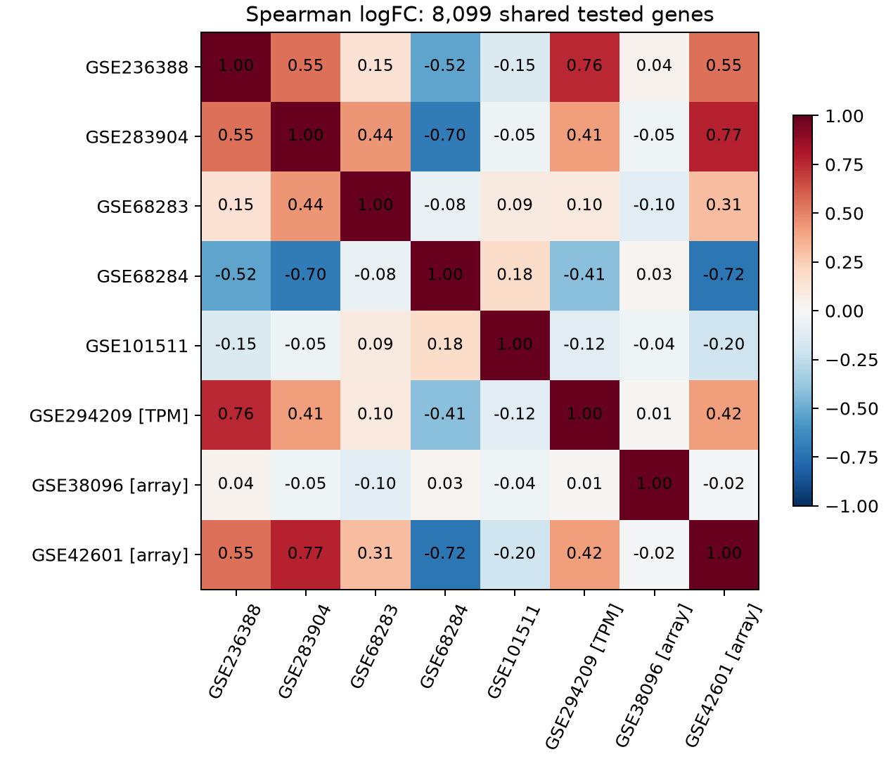

# 生精阻滞跨模型转录组分析

比较小鼠全睾丸转录组中的共性与异质性，并检验单细胞参考能否支持细胞组成解释。项目使用公开数据再分析，不包含自行开展的动物或测序实验。

当前是经过数据和方法核查的探索性分析：8 个队列、56 个主分析样本、7 种遗传扰动。没有将“方向符合预期”当作比例准确性验证，也没有把残差直接称为共享分子机制。

## 主要结果

- 部分模型表达效应呈稳定正相关，也有明显反向关系；不支持直接把所有阻滞模型归为同一个转录组反应。
- 逐个删除 56 个样本，加上 TPM 伪计数及探针汇总变化，共检查 63 个变体。几个较强关联保持方向，Hnrnpgt 的弱关联不稳定；没有据此删除样本。
- 单细胞参考在独立分选资料的早期减数分裂群体上存在失配；细分至 12 个生殖状态后仍未充分解决。因而不报告已验证的细胞数比例或因果组成贡献百分比。



图中为 8,099 个共同受检基因的 Spearman 相关，不是对独立生物重复的显著性检验。TPM 与芯片作为敏感性分支，不能和计数效应完全等量解释。完整说明见 [结果与边界](docs/RESULTS.md)，精简表格见 [结果快照](results_snapshot/README.md)。

## 可选数据扩展（2026-10-23）

原八队列基线保持不变。可选探索分支定向核查了 32 个 GEO 系列，接入 Dcaf2 P9、Pramef12 P2/P7（杂合子对照）和 Msl3 P45（表型阴性比较），新增 24 份全睾丸样本，另检查 20 份分选 WT 表达谱。不同角色不混为“新增阻滞病例”。方法、文件身份问题及复现范围见 [数据扩展记录](docs/DATA_EXPANSION.md)，结果在 `expansion_snapshot/`。

## 数据与分析范围（冻结的八队列基线）

| 队列 | 遗传扰动 | KO / WT | 数据类型 |
|---|---|---:|---|
| GSE236388 | XAP5，D16 睾丸臂 | 3 / 3 | 基因 counts |
| GSE283904 | N6amt1 | 4 / 4 | 基因 counts |
| GSE68283 | Rfx2，P29–30 | 4 / 5 | 基因 counts |
| GSE68284 | Rfx2，P21 | 6 / 5 | 基因 counts |
| GSE101511 | Hnrnpgt，18 dpp | 3 / 3 | 旧转录本特征 counts |
| GSE294209 | Rnu11，P14 | 3 / 3 | 作者提供的 TPM |
| GSE38096 | Sin3a，P0 | 2 / 2 | Agilent 单 Cy3 通道 |
| GSE42601 | Dazap1，P21 | 3 / 3 | Affymetrix mouse4302 |

Rfx2 两年龄队列来自同一研究，不视作两种独立遗传模型。Sin3a 两个 HET 不纳入主对比；XAP5L 的 D56 附睾尾精子不纳入睾丸分析。N6amt1 年龄未由当前官方样本记录确认，不沿用旧表中未经确认的 adult 标签作年龄分析。阻滞分期并非每队列都已获得原始组织学证据，不据旧节点标签作分期因果推断。

各队列独立处理，合并的是基因效应而不是原始表达矩阵。组成探索只用于五个 counts 队列。22 份输入的官方 URL、大小与 SHA-256 见 [资产清单](data/analysis_assets.json)；来源和分组说明见 [数据说明](data/README.md)。

## 复现

需要已安装的 Python、R 和 curl。当前实测 Python 3.14.7 / R 4.6.1；不同 R/Bioconductor 注释版本可能改变基因映射。依赖安装不需要移动系统解释器或使用 sudo。

```bash
git clone https://github.com/Gensouno/spermatogenic-arrest-plan.git
cd spermatogenic-arrest-plan

# 首次安装；已有环境可加 --check 仅检查
bash envs/setup_analysis.sh

# 下载缺失输入并检查冻结校验值
bash envs/python.sh scripts/data_assets.py --download

# 19 个阶段，从输入重算
bash envs/python.sh scripts/run_analysis.py

# 检查随仓库提供的结果快照是否完整
bash envs/python.sh scripts/export_snapshot.py --verify
```

已有输入时用 `scripts/data_assets.py --verify` 检查；也可通过 `--import-from /path/to/existing-project` 从另一目录复制经校验的输入。已有输入若校验不符会停止，不自动覆盖。

### 可选下载代理

需要代理时，将 `envs/download-proxy.example` 复制为项目根目录的 `.download-proxy.local`，把其中 URL 改为本机 HTTP(S) 代理地址。该文件已被 Git 忽略，不提交代理地址或凭据。通过 `envs/python.sh`／`envs/rscript.sh` 运行的下载及依赖安装会继承它；代理不可用时应修复代理，不自动改为直连。未配置此文件时保留调用者的代理环境。直接运行系统 Python/R 不会读取此项目配置。

本机另做了没有旧结果和中间文件的新目录重跑，关键结果表一致；此检查复用已安装的依赖，**不是**另一台机器或空依赖环境安装验证，也没有在删除原数据后测试全部首次网络下载。耗时和详细边界见 [复现记录](docs/REPRODUCIBILITY.md)。

## 项目导航

- [METHODS](docs/METHODS.md)：分平台处理、基因集合、敏感性与组成检查。
- [RESULTS](docs/RESULTS.md)：主要数字、负结果及解释边界。
- [REPRODUCIBILITY](docs/REPRODUCIBILITY.md)：运行顺序、环境与验证范围。
- [面试讲解提纲](docs/INTERVIEW.md)：帮助理解自己使用的数据、代码和局限。
- [HISTORY](docs/HISTORY.md)：早期 AI 草稿、被推翻的假设与保留原因。

`code/`、`scripts/` 为当前实现；`results_snapshot/` 为带校验值的精简成果；`results/` 为重算生成的完整产物，不入库。原始数据、依赖环境和大矩阵不提交。

`PLAN.md`、编号 `docs/01`–`04`、`notes/` 及三个编号旧分析脚本是历史材料，不是当前执行方案。

## 来源与许可

单细胞参考为 [Green et al., Dev Cell 2018](https://pubmed.ncbi.nlm.nih.gov/30146481/)，外部分选资料为 [da Cruz et al., BMC Genomics 2016](https://link.springer.com/article/10.1186/s12864-016-2618-1)。各队列出处见资产清单与逐样本 GEO 证据。

原创代码使用 [MIT](LICENSE) 许可；上游数据、原论文与补充材料保留其原有许可和引用要求，不因本仓库软件许可而改变。
