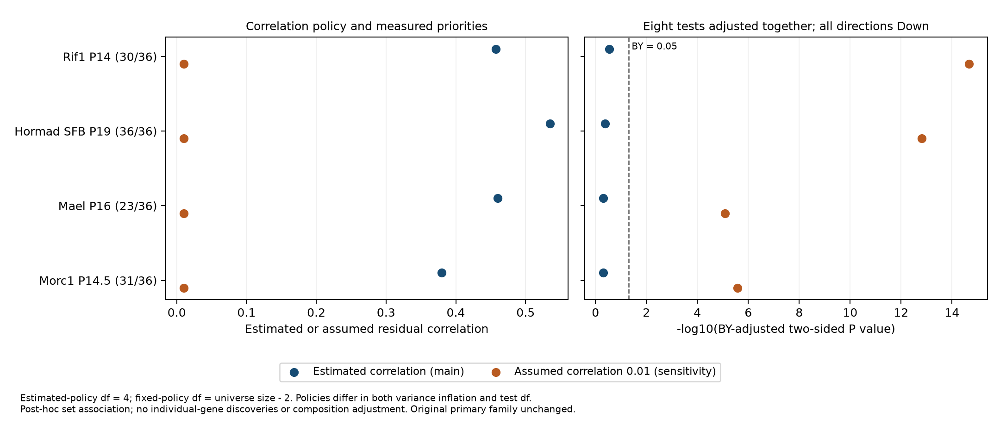

# Competitive testing of the fixed descriptive priority set

## Question and interpretation

This separate exploratory branch asks whether the fixed 36 downward priorities differ directionally from the other eligible primary-universe genes in four additional whole-testis count contexts. It uses the correlation-aware CAMERA procedure [Wu and Smyth, 2012](https://doi.org/10.1093/nar/gks461). The procedure and its two-sided P value are documented in the [official limma manual](https://bioconductor.org/packages/release/bioc/manuals/limma/man/limma.pdf); the exact installed limma 3.68.5 function is archived with the outputs.

The analysis contract was written before this branch's CAMERA results. Candidates, sources and gene effects had already been explored. This timing is post hoc, not preregistration or confirmatory validation.

**Main result:** all four set directions are Down, but none passes either joint BY or BH adjustment under the main estimated-correlation policy. All four pass under the assumed-correlation 0.01 sensitivity. The conclusion is sensitive to model assumptions. The earlier primary directional-replication family still has zero formal discoveries.

## Fixed inputs and model

- Reconstruct four six-library RNA count matrices from the 38 previously hash-bound cached assets. No new downloads, samples or exclusions are introduced.
- Preserve native source controls: Rif1 source controls with unresolved exact alleles/Cre, Hormad SFB-tagged contrast, Mael HET controls and Morc1 source tg/+/tg/tg labels. A control analysis alias does not certify literal WT or animal independence.
- Refit source-ID filterByExpr, TMM, voom, lmFit and eBayes with an intercept and perturbation coefficient. Every source's full-fit gene order, logFC, t statistic, P value and AveExpr reconcile with the frozen preceding fit (maximum absolute numerical errors below 6e-14).
- Restrict the already weighted voom EList to original primary symbols intersecting source-tested globally unique symbols. No subset renormalization or weight recomputation is performed. CAMERA estimates its moderated variance distribution on that restricted universe, so its internal statistics are not claimed to be the unchanged full-source eBayes statistics.
- Use all available members of the fixed 36; the complement includes every other eligible gene, including earlier descriptive candidates. Missing priorities remain explicit, not zero effects.
- Use CAMERA directional two-sided tests, without ranks or a variance trend. P values are not halved. This is a competitive comparison, not a test against zero expression change or a stage-matched comparison.

## Correlation policies and complete family

The main policy estimates each set's weighted residual correlation (`inter.gene.cor=NA`). With `allow.neg.cor=FALSE`, used variance inflation is at least one. There are only four residual degrees of freedom. The sensitivity assumes `inter.gene.cor=0.01`, the installed default; its test uses universe size minus two degrees of freedom. The two policies differ in **both variance inflation and test degrees of freedom**. Their P-value contrast does not isolate a causal effect of correlation, and the fixed-policy result must not override the estimated-policy null.

All eight tests (four contexts times two policies) are adjusted together: BY is primary and BH is a sensitivity, threshold <0.05. Threshold crossings are conditional on the expression-model and CAMERA assumptions; this is not empirical biological FDR validation. The original 38,700 directional hypotheses are untouched.

| Context | Priorities / 36 | Universe | Estimated correlation | Used variance inflation | Estimated-policy P | Joint BY | Fixed-0.01 joint BY |
|---|---:|---:|---:|---:|---:|---:|---:|
| Rif1 P14 | 30 | 9,558 | 0.4572 | 14.2598 | 0.06633 | 0.28844 | 2.11857e-15 |
| Hormad SFB P19 | 36 | 9,647 | 0.5348 | 19.7179 | 0.11353 | 0.41140 | 1.51316e-13 |
| Mael P16 | 23 | 9,411 | 0.4601 | 11.1215 | 0.18606 | 0.50568 | 8.33972e-6 |
| Morc1 P14.5 | 31 | 9,444 | 0.3797 | 12.3908 | 0.17425 | 0.50568 | 2.66162e-6 |

The small sample size makes estimated correlation uncertain. No source sample was removed to change this result. High residual correlation is an observation under this model; it does not identify cellular composition, batch, outliers or a regulatory mechanism as its cause.



## Verification and artifacts

```bash
bash envs/python.sh scripts/run_competitive_set.py
bash envs/python.sh scripts/plot_competitive_set.py
bash envs/python.sh scripts/check_competitive_set.py --reproduce
bash envs/python.sh -m unittest tests/test_competitive_set.py
```

`data/competitive_set_contract.json` defines the question, universe, policies, multiplicity and limits. `competitive_set_snapshot/` contains results, 144 priority coverage records, 38,060 universe rows, source-fit reconciliation, runtime versions, installed CAMERA source, the figure and a fresh-directory reproduction record. The checker independently recalculates joint-family BY/BH and verifies contrast reversal, coverage, universe identity and inherited source fits. Reproduction rereads the same cached processed deposits, refits all contexts and reproduces four matrices, five tables, two JSON records, one source-text record and one figure. This does not reproduce upstream raw-read alignment or establish new biological replication.

Freeze once, after checks, using `scripts/export_competitive_set.py`. The exporter refuses to overwrite a frozen manifest. Older snapshots and their bound sources remain unchanged.

## Research limits

The selected set is post hoc, source controls/ages/alleles differ, and animal/pooling/batch structure remains partly unresolved. A competitive set result cannot confer FDR control on its individual genes, add independent genetic votes, establish stage specificity, adjust cellular composition or identify a shared cell-intrinsic mechanism. A null result also does not establish absence of a biological effect. Independent design and source metadata remain more informative next steps than selecting the favorable correlation policy.
