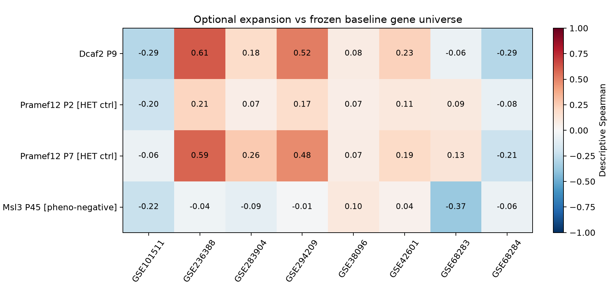
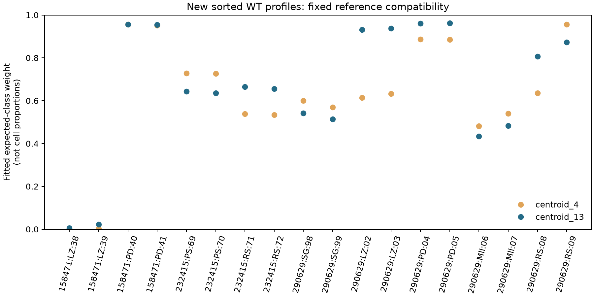

# 数据扩展：增加模型、对照和独立分期检查

日期：2026-10-23。本轮定向核查了 32 个 GEO 系列，不是完整系统综述。筛选依据为原始来源、组织、对照、单位、重复和文件身份，不按与旧结果的相关方向选择数据。原八队列结果和已发布快照保持不变，扩展结果另存。

## 已接入的四个对比

| 数据 | 角色 | KO / 对照 | 本轮受检基因 | FDR<0.05 且 abs(logFC)>1 |
|---|---|---:|---:|---:|
| [GSE259242](https://www.ncbi.nlm.nih.gov/geo/query/acc.cgi?acc=GSE259242)，Dcaf2 P9 | 新的全睾丸扰动比较 | 3 / 3 | 14,247 | 735 |
| [GSE117706](https://www.ncbi.nlm.nih.gov/geo/query/acc.cgi?acc=GSE117706)，Pramef12 P2 | 杂合子对照敏感性分支 | 3 / 3 | 14,904 | 2 |
| 同上，Pramef12 P7 | 同一遗传模型的另一年龄 | 3 / 3 | 15,167 | 396 |
| [GSE235777](https://www.ncbi.nlm.nih.gov/geo/query/acc.cgi?acc=GSE235777)，Msl3 P45 | 表型阴性比较，不是阻滞病例 | 3 / 3 | 18,598 | 0 |

共增加 24 份全睾丸样本。Pramef12 对照明确为 `+/-`，不是 WT；P2/P7 也不是两种独立遗传模型。Dcaf2 官方 genotype 为 control／conditional knockout，不凭标题补写未经确认的对照等位基因。Msl3 的原研究报告生精表型无明显影响，不代表所有转录本必须不变，也不是已知零效应的统计真值。本轮没有检出 DEG，仍可能受年龄、功效与处理流程影响。

Dcaf2 原表同时有 count 与 FPKM 列，仅导入明确的 `_count` 列。Pramef12 读取 featureCounts 的计数列，不将 Length 等注释误当表达；Msl3 读取来源明确描述的 STAR 第 2 列非链特异计数，并保留三种链模式总量诊断。Ensembl 基因统一用当前 org.Mm.eg.db 单值映射，同 symbol 求和。各队列计数质量保留率最低为 Dcaf2 99.0%、Pramef12 P2 96.6%、P7 98.2%、Msl3 97.7%；旧注释损失仍是限制。

新增队列各自进行过滤、TMM/voom/limma，并做 24 次逐样本删除。与旧八队列比较时使用原 8,099 个共同受检基因作为上限，再取该新增对比的受检交集；实际基因数逐行保存，不把不同基因宇宙的相关混用。

Dcaf2 与 XAP5 的描述性相关约 0.610；Pramef12 P7 与 XAP5 约 0.585，P2 约 0.214。这不证明某条共同机制，也不能只凭两个年龄的不同统计结果证明效应发生了显著的年龄变化。留一范围只变动新增研究，旧研究保持不变，不是双侧完整稳健性或置信区间。



## 新增的分选 WT 检查

使用未参与前轮参考细分的三组资料：

- GSE158471：Cnot4 WT 的 LZ/PD，各两份 FPKM 谱；mm9 符号与技术差异保留。
- GSE232415：单独核对内部标签的 WT PS/RS，各两份整数计数谱；不使用有身份问题的全睾丸文件。
- GSE290629：作者标注的 WT SG、preL、LZ、PD、MII、RS，各两份计数谱。preL 是过渡状态，不强行赋予精原／减数分裂二元真值。

共 20 份表达谱，其中 18 份有预先指定的大类目标。复用前轮已经生成的参考及基因宇宙，不依据这些新资料重新选标记、调参或改标签。复制来源的“rep1/rep2”不等于已确认不同年龄／阶段均来自独立动物；不把 20 个谱称为 20 个独立动物。

同表四类参考与 13 成分参考的“最大权重类别符合来源大类”的数量分别为：Cnot4 2/4、2/4；NKAPL 分选 WT 4/4、4/4；H3mm15 的可评分 WT 谱 10/10、9/10。细分参考并不在所有来源上改善诊断。该结果显示适配具有研究依赖性：不能笼统说所有 LZ 都被误判，也不能凭部分来源匹配就宣布比例准确。不同技术、年龄、基因覆盖和阶段内状态仍可能参与失配。



这里是表达谱兼容性，不是已知细胞比例混合物恢复。参考的基因宇宙来自前次外部资料的可用性，仍可能限制推广。

## 暂缓或排除的重点资料

GSE232415 的全睾丸档案中，有 15 个文件的内部样本标签与文件名不一致，另有 6 个文件属于完全相同表达向量的重复组。例如 GSM7331931 与 GSM7331932 归档为不同样本，但解析后向量相同。它们不能无核实地当成独立重复，也不能根据目标基因表达猜测应如何重贴标签。完整核对记录在扩展快照中。这只说明当前公共补充文件需要澄清，不据此推断原实验或整篇论文失效；本轮未联系作者或替用户发布 issue。

GSE278121 与 GSE290783 尽管文件名写 raw_counts，分别约 48% 和 95% 的矩阵条目不是整数；可能涉及估计计数或归一化，当前证据不足以确认尺度。未四舍五入塞进原始计数流程。后者的 genotype 字段还重复写为 tissue，需要额外来源核实。

GSE121904 是有用的年龄参考候选，但需尊重捕获方法和成年富集差异、补齐细胞标签。GSE230746 提供 P15 两个 WT 生物重复和带作者标签的对象，但压缩对象为 1,122,924,799 字节，本轮未下载或宣称已使用。GSE180204 的 P1 Nanos3-Cre 与 P3 Dhh-Cre 各有 4 对 4，是下一轮值得优先核查的全睾丸资料，但两靶细胞类型不能混成一个对比。

还纠正了检索误导：GSE95225 实际为 ChIP/input；GSE341157 的官方内容为 NIH3T3 ChIL-seq，不能仅凭检索摘要把它纳入全睾丸 RNA-seq。其余候选状态和原始元数据 URL／SHA 见 `data/expansion_review.json`。

## 复现与本轮状态

先按主 README 完成八队列基线。扩展单独运行：

```bash
# 已有缓存时不会主动发起下载；首次缺数据可显式加 --download
bash envs/python.sh scripts/run_expansion.py
# 从缓存原始输入及冻结基线产物，在新目录复跑扩展并比较结果
bash envs/python.sh scripts/check_expansion_reproduction.py
```

入口检查所需缓存，保存每阶段日志于 `logs/expansion/`。新输入来源和哈希位于 `data/expansion_assets.json`，筛选证据位于 `data/expansion_review.json`；小型成果在 `expansion_snapshot/`，完整矩阵及结果在 Git 忽略的本地目录。新增代码测试覆盖整数检查、计数列选择、分隔符、重复标识及杂合子标签等；另有四项本地代理配置测试，合计 19 项测试通过。

新目录复跑已通过：复制缓存原始输入与冻结基线效应／参考产物，在不下载数据的情况下重新运行扩展，12 张结果表在指定数值容差内一致（相对容差 1e-10、绝对容差 1e-12）。记录见 `expansion_snapshot/reproduction.json`。此次复跑共享本机已安装的 Python/R 依赖，未验证空依赖安装，也未重新计算八队列基线；不能将主分支此前的 19 阶段／18 表复现结论直接套用到新增分支。

本轮为单独保存的可选探索扩展，不覆盖原八队列基线。后续优先核实尚存的控制组、单位与文件身份问题，再决定怎样整合为主分析。
