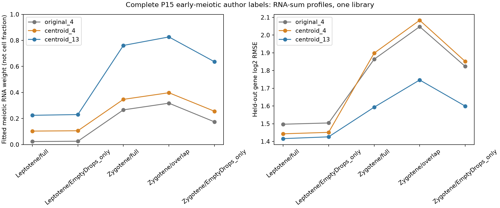

# 完整 P15 早期减数分裂参考适配诊断

日期：2026-10-25。本轮承接 [前轮作者标签诊断](LABELED_REFERENCE.md)，补齐同一研究 P15 的 EmptyDrops 计数。前轮的结论只覆盖 266 个 CellRanger 重叠偶线期细胞；本轮不把这个事后追问称为未经接触的独立验证。旧快照和其绑定代码不改写。

## 来源与取数范围

来源为 [E-MTAB-6946 官方研究](https://www.ebi.ac.uk/biostudies/arrayexpress/studies/E-MTAB-6946)及 [单研究 API](https://www.ebi.ac.uk/biostudies/api/v1/studies/E-MTAB-6946)，对应 [Ernst 等，Nature Communications 2019](https://doi.org/10.1038/s41467-019-09182-1)。依据固定版本的 [作者说明](https://github.com/MarioniLab/Spermatogenesis2018/tree/5d10fe6017651e4cc583d12ba0bac49c51717329)，元数据顺序对应矩阵细胞列、基因表顺序对应矩阵行。不执行或复制作者分析函数。

只取完整正常小鼠 P15 文库 `do18195`，并非整个图谱。原始 EmptyDrops 矩阵声明 32,105 行、68,937 列、163,091,514 个非零项，2,224,359,116 字节；所取连续列为 25,833–39,000，共 13,168 个细胞、28,013,465 个非零项。其精确字节区间为 `[797347902,1183894246)`，即 386,546,344 字节。完整矩阵整体 SHA-256 未获得；仅记录实际取得窗口及配套输入的 SHA-256。

先依据作者逐细胞检测特征数定位完整列边界，要求服务器返回精确 `206`、`Content-Range` 和一致的强 ETag，再以 8 MiB 分块取得。断点恢复只重用来源版本、范围及哈希均一致的完整块；不匹配缓存停止而不覆盖。网络下载经过本机代理，不回退直连。公开清单保留来源和校验信息，不包含机器代理地址。取数预算和分析前范围见 [contract](../data/emptydrops_p15_contract.json)。这是一个研究记录和一个原矩阵窗口，不是对数万条数据库记录的逐条检索。

所有 13,168 个 EmptyDrops 细胞及原 CellRanger P15 文库的 4,258 个细胞均须逐一核对总计数和检测特征数，才进入拟合。SDRF 的细胞数属于 CellRanger 分支，不能拿来否定或替代 EmptyDrops 的 13,168 个细胞。

## 固定设计

按 `Library+Barcode` 连接两个处理分支：3,487 个重叠细胞、9,681 个 EmptyDrops-only 细胞，另有 771 个 CellRanger 细胞不在 EmptyDrops 中。不能把两个集合当严格包含关系。固定使用作者 `P15Clusters`：Leptotene、Zygotene、Pachytene_1/2 对应减数分裂，三个精原标签对应精原细胞，其余明确体细胞标签对应体细胞。`Outliers` 排除，少于 20 个细胞的组列入清单但不拟合，不并组凑数。

报告完整、重叠、EmptyDrops-only 三个细胞集合的全部合格类型。两个计数分支的同条形码对照也统一使用同一份 `P15Clusters`，不是一边用旧标签、一边用新标签。对每组同时计算计数求和与等细胞归一化均值；后者先用作者原始细胞总计数归一化，再取均值。它们是同一批细胞的处理视角，不是生物学重复。

仅保留唯一小鼠 Ensembl 特征对应的唯一 symbol；排除人特征、缺失 symbol 和全部歧义小鼠 symbol。两个计数分支与原参考取相同的基因交集，所有本轮拟合使用完全一致的基因、五折和权重。原 `original_4`、`centroid_4`、`centroid_13` 参考保持不变，不重新选标记、训练参考或调参。权重为原同表四类参考均值加一后的平方根倒数；种子 20261024 的五折在原参考完整排序基因集合上产生后再取交集。

共有基因列总量在分折前归一化，因此留出基因仍参与归一化分母。这是表达适配诊断，不能称完全前瞻的缺失基因预测。减数分裂大类权重是拟合 RNA 权重，不是细胞数比例；最大大类与作者标签一致也不等于经校准的分类准确率。作者标签来自其转录组分析，不是独立组织学纯度真值。全部分组都保留，避免只报道改善的 L/Z。

## 执行结果

已完成下载、逐细胞核验和固定参考拟合。54 次矩阵范围请求取得 47 个完整传输块，窗口 SHA-256 为 `a4f25a71f2abad0a3ece69a2946048587b7b937352cbf3b73dcfa8ecd5fef818`；配套基因表另作一次请求，研究及作者标注复用前轮已冻结缓存。原矩阵窗口和清单见 [输入规格](../data/emptydrops_p15_assets.json)。EmptyDrops 的全部 13,168 个细胞和 CellRanger 的全部 4,258 个 P15 细胞，总计数及检测特征数均逐一一致。核验对象包括随后排除的细胞，而非只核验进入拟合者。

排除 211 个作者 Outliers 后，完整集合包含 15 个类型组、12,957 个细胞；重叠集合 11 个合格组、3,364 个细胞；新增集合 14 个合格组、9,561 个细胞。重叠细线期 13 个、重叠 Leydig_2 17 个、新增 Pachytene_2 两个均不足阈值，不拟合。另用旧版计数为同样的 11 个合格重叠组建立对照；共 51 个“计数分支×细胞集合×类型”组、两种加权、102 份处理谱，均来自同一 P15 文库，不能累加为独立样本。

EmptyDrops 的 32,105 个特征包含 32,070 个小鼠和 35 个人特征；过滤后为 32,011 个唯一小鼠 symbol。与 CellRanger 共用 31,706 个唯一小鼠 symbol，最终与三个固定参考共用 **11,852 个基因**。唯一小鼠表达量覆盖为 99.94%–99.99%，参考共有基因覆盖各处理谱全部唯一小鼠表达量的 83.42%–92.59%。这些覆盖率仅描述保留表达量，不是参考准确率。

### 偶线期改善延续，细线期仍失配

下表为计数求和结果，两个 RMSE 在同一行、同一基因宇宙内比较。不同细胞群之间的 RMSE 大小不能直接当成分类质量排序。“减数权重”指减数分裂大类的拟合 RNA 权重，不是细胞数百分比。

| 作者标签／集合 | 细胞数 | 同表四类减数权重 | 13 成分减数权重 | 13 成分最大大类 | 留出 log2 RMSE，四类／13 成分 |
|---|---:|---:|---:|---|---:|
| Leptotene，完整 | 907 | 0.103 | 0.225 | 精原细胞 | 1.443／1.416 |
| Leptotene，新增 | 894 | 0.106 | 0.230 | 精原细胞 | 1.451／1.426 |
| Zygotene，完整 | 938 | 0.347 | 0.761 | 减数分裂 | 1.898／1.593 |
| Zygotene，新增 | 672 | 0.256 | 0.636 | 减数分裂 | 1.851／1.599 |
| Zygotene，重叠 | 266 | 0.398 | 0.826 | 减数分裂 | 2.084／1.747 |

等细胞均值也得到相同的 L/Z 最大大类方向：完整偶线期的 13 成分减数权重为 0.686，新增偶线期为 0.632；完整／新增细线期分别为 0.243／0.245，仍以精原细胞为最大大类。不能只呈现计数求和较有利的偶线期权重。

原始元数据及实际计数核验表明，新增细胞复杂度明显较低：细线期新增／重叠细胞的总计数中位数为 1,677.5／6,847，检测特征数中位数为 1,140.5／2,984；偶线期分别为 1,949.5／9,770.5 个计数、1,259／3,246.5 个特征。这是同一文库内的描述性差异，不是动物重复支持的显著性检验，也不能单独判定失配的原因。

全部完整类型组中，原四类、同表四类、13 成分的最大大类匹配分别为 12/15、12/15、13/15；13 成分仍失配于 Leptotene 与 Sertoli_2。等细胞均值下，13 成分匹配 14/15，仍失配于 Leptotene。该匹配数只是作者标签一致性描述，不等于测得的分类准确率。细分参考的加权条件数为 36.47，而同表四类为 2.63，分量相关性及可辨识性限制仍然存在。



### 同条形码对照：不能把变化归于计数版本

在全部 11 个合格重叠类型组中，对 31,706 个共有小鼠 symbol 的逐基因汇总计数，两版计数均完全一致；使用相同基因、标签、权重和归一化后，三个参考、两种加权的配对拟合权重和留出误差差值均为零。这是**类型组汇总计数**一致性，不宣称已逐细胞逐基因证明两文件完全相同。

因此，新增细胞纳入后的变化，不能解释为在同一批细胞上换计数版本直接改变了本轮诊断。前轮偶线期数值采用 11,856 个参考共有基因，本轮为跨计数分支统一的 11,852 个，留出误差有很小差异；前轮表格与本轮表格不能不加控制直接相减。本轮的同条形码配对比较才使用完全一致的基因宇宙。

本轮补上了此前缺失的大多数低复杂度早期细胞，支持细分参考对偶线期的改善延续，但明确暴露出**细线期表达适配仍不足**。它没有解决外部 Cnot4 LZ 失配，也不支持现在就给出体内细胞数比例或组成贡献的因果百分比。下一阶段应优先评估有独立来源与明确细线期标签的参考和分选验证，先检验表达可辨识性；不能直接根据本轮标签重训后把同一批细胞当独立验证。

## 复现与文件

首次获得本轮输入：

```bash
bash envs/python.sh scripts/run_emptydrops_p15.py --download
```

本轮另依赖前轮冻结的 CellRanger P15 窗口、基因表、来源清单及原三个参考；上述命令只恢复本轮清单中的缺失输入，不负责从零生成整个项目的前置参考。完整前置分析见项目 README 与前轮诊断文档。有效缓存直接复用；已有文件哈希不符停止。

缓存齐备时，以下步骤不联网：

```bash
bash envs/python.sh scripts/run_emptydrops_p15.py
bash envs/python.sh scripts/check_emptydrops_reproduction.py
bash envs/python.sh scripts/export_emptydrops_p15.py
bash envs/python.sh scripts/check_emptydrops_p15.py --inputs
bash envs/python.sh scripts/check_labeled_snapshot.py --inputs
bash envs/python.sh scripts/check_project.py --inputs
```

原始窗口、分块缓存和完整细胞 QC / 类型表达矩阵留在 Git 忽略目录，紧凑结果在 [本轮快照](../emptydrops_p15_snapshot/README.md)。新目录重跑复用冻结输入和已安装依赖，不等于空环境安装或完整图谱重处理。文件完整性不替代科学有效性判断。

本轮已实际完成新目录离线重跑，14 张表与两份来源／设计 JSON 一致（仅忽略聚合耗时），见快照 `reproduction.json`；包括完整类型表达矩阵、两个分支逐细胞 QC 和基因折数表。51 项单元测试通过，覆盖条形码连接、分组汇总与加权、计数不一致拒收、基因歧义、精确范围／ETag、断点缓存与缺失输入恢复等。缺失输入恢复使用模拟传输测试，没有为此删除真实原始缓存重复下载。旧五组快照及其绑定代码／规格的完整性检查均通过。

数据库检索与来源留痕采用 database-lookup 技能流程；工具方法文献：Kassis T, Agarwal V, He Y, Patel D, Brueckner AM (2026), *Scientific Agent Skills: A Library of Procedural Knowledge for Research Agents*. [arXiv DOI](https://doi.org/10.48550/arXiv.2609.00065)。此引用仅说明流程来源，不验证本项目生物学结论。
