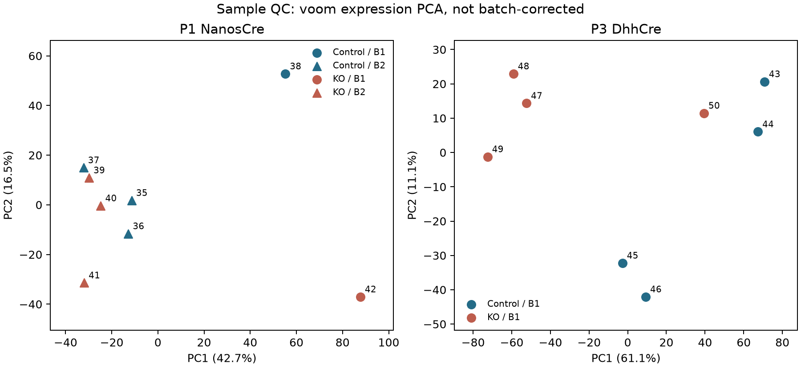
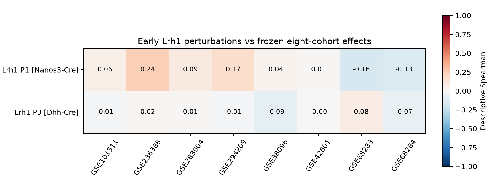

# 早期 Lrh1 对比及 Ppp2ca 文件核查

日期：2026-10-24。状态：已执行并完成新目录复跑核查的独立后续分析。原八队列和 2026-10-23 四对比扩展的代码、结果快照均不覆盖。这次从上一轮候选中定向核查两个 GEO 系列，不是新的完整系统检索。

## 来源与样本角色

主来源为 NCBI GEO，物种为小鼠（Mus musculus，taxon 10090）。按固定 accession 下载两份 SOFT 及三份处理文件，共 5 份、4,308,621 字节。完整 HTTPS URL、字节数和 SHA-256 见 [输入清单](../data/followup_assets.json)。下载通过本机代理；不将代理配置写入公开成果。

| 来源 | 数量与角色 | 决定 |
|---|---|---|
| [GSE180204](https://www.ncbi.nlm.nih.gov/geo/query/acc.cgi?acc=GSE180204)，Lrh1 P1 Nanos3-Cre | 4 cKO / 4 noCre；对照 Lrh1 flox/- | 早期生殖细胞靶向扰动，独立分析 |
| 同系列，Lrh1 P3 Dhh-Cre | 4 cKO / 4 noCre；对照 Lrh1 flox/flox | 早期支持细胞靶向扰动，独立分析 |
| [GSE181132](https://www.ncbi.nlm.nih.gov/geo/query/acc.cgi?acc=GSE181132)，Ppp2ca P56 | 2 WT / 2 cKO 的转录本 FPKM | 只核查文件，不纳入原始基因计数分析 |

不能将两组 Lrh1 的对照改写为 WT，不能把同一基因的两个 Cre 实验称为两种独立遗传模型。两组的年龄、靶细胞和控制等位基因同时不同，不能据此估计纯年龄效应或纯靶细胞效应。P1/P3 为早期取样，不能直接等同于已有减数分裂阻滞的组织；原研究的后续生精缺陷也不意味着这些取样时点已经出现相同表型。

## 文件、注释和批次

Lrh1 的 `.rdata.gz` 有两层 gzip。取出作者 DESeqDataSet 的原始 `counts` 槽，核查 55,401 行 × 16 列、非负整数、逐样本总量与对象元数据一致、矩阵列与来源样本一一对应。没有执行随附 `plot_fpkm` 函数，没有沿用存储对象的设计或拟合结果，也没有把另一个 XLSX 中的组均值 FPKM 当成样本计数。

当前 org.Mm.eg.db 单值映射只能解释约 94.7%–97.7% 的计数质量。最初的仅 symbol 导入在质量阈值处停止，尚未进行差异拟合；后改为保留全部原始 Ensembl 基因计数进行过滤、归一化和差异分析，而不是降低阈值或抛掉未映射计数。仅在跨队列比较时使用能唯一映射到 symbol 的受检基因；同一 symbol 对应多个受检编号时全部排除，不按效应大小挑选。此导入策略与前轮 symbol 汇总策略并不完全相同，是比较的一个限制。

R 对象另有作者批次字段：P1 的 B1 含 1 对 1、B2 含 3 对 3；P3 全为 B1。P1 主模型为 `~ batch + group`，P3 为 `~ group`。P1 同时保留不校正批次和仅 B2 的敏感性对比，不据 PCA 自动删样。批次为何形成、是否还有动物或制备层面的依赖，当前来源未充分说明。



PCA 使用 voom 表达，未做批次校正；点旁数字是 GSM 编号末两位，不是额外样本。

## 已得到的结果与不一致

使用各组独立的 filterByExpr、TMM、voom/limma，效应方向为 cKO 减 noCre；阈值为 BH FDR<0.05 且 abs(log2FC)>1。

| 对比 | 主分析受检基因 | limma 差异基因 | edgeR 稳健准似然敏感性 |
|---|---:|---:|---:|
| P1 Nanos3-Cre | 16,773 | 1 | 2 |
| P3 Dhh-Cre | 16,621 | 0 | 3 |

edgeR 准似然是在看到与作者显著性结果不一致后增加的诊断，使用相同受检基因和设计，不替换预先选定的 limma 主结果，不按哪个方法发现更多基因来选择报告。两方法 logFC 的 Spearman 约为 P1 0.981、P3 0.993，但效应接近不代表显著性完全相同。

作者 P1 表中的 Slc25a42、Nxf2、Chodl、Cbln1 四个基因，主分析效应方向均一致，效应值也接近，但显著性未逐一复现。例如 Nxf2 的本轮 logFC 约 -1.216、FDR 约 0.136；不能写成“复现了四个显著基因”。作者使用 DESeq2，本轮未重新运行该方法，尚不能把不一致归因于单一原因，更不能据此宣称原论文错误。该四基因检查有原文选择偏倚，只能帮助检查方向和样本对应，不能验证整体统计准确率。

P1 只保留 B2 时有 15,570 个与主分析共同受检基因，效应相关约 0.603，阈值下未检出差异基因。删去 B1 中任一份样本的留一效应相关也降至约 0.613；这提示结果对该批次的少量样本较敏感，不是删除它们的充分理由。16 次逐样本删除均保留记录；留一范围不是置信区间。

与原八队列的比较仍限定于冻结的 8,099 基因宇宙，再取当前唯一映射受检交集，P1 为 7,955、P3 为 7,980 个基因。与 XAP5 的描述性相关分别约 0.238、0.023；前者在只删除 Lrh1 样本时为约 0.074–0.258。原八队列保持不变，因此不是两研究同时扰动的完整稳健性检查。



这些结果不支持把不同细胞靶向、不同发育时期的扰动直接拼成一个强共性机制；也不能把未检出显著差异解释为生物效应不存在。

## Ppp2ca 与未使用的数据

四个 Ppp2ca 附件均为带 UTF-16 BOM 的单列 FPKM，内部样本列与文件名一致，表达向量互异；每个文件有 11,304 个 Ensembl **转录本**编号，约 88%–92% 的条目为非整数。没有将它们四舍五入、没有当作基因 counts，也没有把处理后文件称为完整转录组。未来若做 FPKM 敏感性分析，仍需解决转录本注释、特征覆盖和仅 2 对 2 的功效限制。

另对 GSE121904 文件做了大小检查（53,793,304 字节），但尚未下载、提取细胞标签或用作年龄参考。不能把它列入已执行的分期验证。

## 运行与验证范围

先按主 README 运行冻结基线，获得原效应矩阵。后续入口与旧扩展分开：

```bash
# 缓存齐全时不联网；初次需要获取文件时显式加 --download
bash envs/python.sh scripts/run_followup.py
# 复制原始后续输入和冻结基线效应，在新目录复跑
bash envs/python.sh scripts/check_followup_reproduction.py
```

本轮共 23 项代码测试通过。新目录复跑比较 16 张表，允许相对容差 1e-10、绝对容差 1e-12；记录见 [复跑记录](../followup_snapshot/reproduction.json)。共享已安装依赖，未验证空依赖安装，也未重新计算旧八队列或前轮四对比。小型成果另存 `followup_snapshot/`，完整差异表和日志保留在 Git 忽略的本地目录。不报告细胞数比例准确性或因果组成贡献。

## 引用与检索流程

- 原研究：[Agrimson et al., PLOS Genetics 2022](https://doi.org/10.1371/journal.pgen.1010088)。样本元数据和附件以 GEO 原始记录为依据；论文补充表用于明示的四基因方向检查。
- 检索与来源留痕采用 database-lookup 1.8 技能流程：[Kassis, T.; Agarwal, V.; He, Y.; Patel, D.; Brueckner, A. M. (2026), Scientific Agent Skills: A Library of Procedural Knowledge for Research Agents](https://doi.org/10.48550/arXiv.2609.00065)。这不是统计或生物结论的验证来源。
