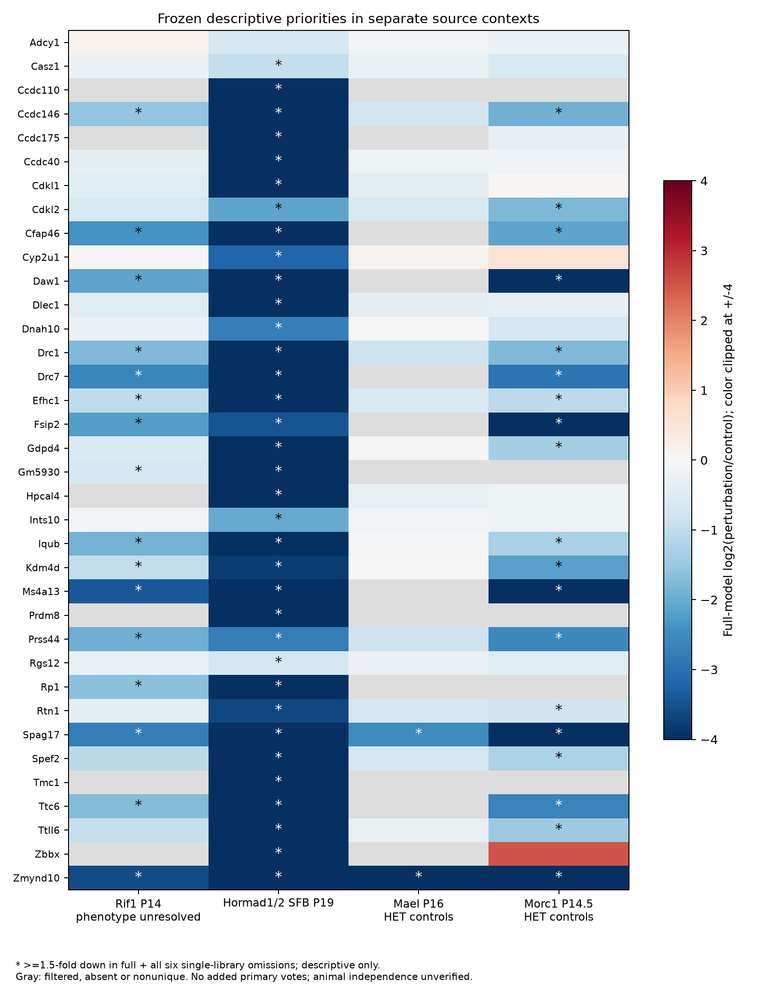

# Additional whole-testis count contexts

This exploratory extension adds source audits and separate count models. It does
not alter the frozen four-unit primary family, which still has zero adjusted
directional replication discoveries. Neither omission stability nor a new source
count establishes a shared cell-intrinsic mechanism.

## Source discovery and decisions

Four explicit GEO DataSets queries returned 13, 17, 30 and 50 series, respectively,
and resolved to 102 unique series. Count-first retrieval, UID-to-accession resolution
and exact cached response identities are recorded. Nine series received detailed
sample-metadata inspection; the other 93 were not reviewed at sample level. This
is a targeted extension, not an exhaustive systematic survey. Discovery followed
the database-lookup workflow described by [Kassis et al. (2026), preprint](https://arxiv.org/abs/2609.00065).

The initial three contexts were selected by metadata and matrix schema before
their differential-expression analysis. Morc1 was added after those first outcomes,
when further inspection of the preselected metadata identified an explicit raw-read
column and per-mouse libraries, and before examining Morc1 expression outcomes.
There was no selection using candidate concordance. The analysis remains post hoc
and is not presented as preregistered.

| Context | Source | Control | Important boundary |
| --- | --- | --- | --- |
| Rif1 P14 | [GSE294151](https://www.ncbi.nlm.nih.gov/geo/query/acc.cgi?acc=GSE294151) | GEO wild type; matrix con | P14 is in the series design. GEO library names and matrix names lack an explicit crosswalk; group/suffix aliases are tentative. Phenotype, exact allele and Cre control remain unresolved. |
| Hormad1/2 SFB P19 | [GSE274491](https://www.ncbi.nlm.nih.gov/geo/query/acc.cgi?acc=GSE274491) | GEO control; article WT comparator | N-terminally tagged alleles, not a double knockout. The [source article](https://doi.org/10.1038/s41467-025-57702-z) reports male mid-pachytene arrest. |
| Mael P16 | [GSE222415](https://www.ncbi.nlm.nih.gov/geo/query/acc.cgi?acc=GSE222415) | Mael heterozygous | The [source article](https://doi.org/10.1371/journal.pgen.1010797) describes comparable tissue complexity at P16. RNA-seq and ribofootprint assays must not be pooled as additional RNA replicates. |
| Morc1 P14.5 | [GSE63048](https://www.ncbi.nlm.nih.gov/geo/query/acc.cgi?acc=GSE63048) | Morc1 tg/+ | GEO says each library used one individual mouse. The [source article](https://doi.org/10.1038/ncomms6795) uses tg/tg mutants, whereas GEO uses KO. Exact deposited GSM files define the analysis. |

All contexts contain three control and three perturbation RNA libraries. Source
phenotype descriptions do not supply independent histology for every deposited
sample. Litter pairing, batch structure and individual identities remain incomplete.
The Morc1 erratum (PMID 26159654, PMC5784397) was read: it corrects production-swapped
bars in Figure 2f/g; no published figure values were used for these fits.

The audit also retains exclusions and deferrals: Zfp541 files declare RPKM/FPKM;
Nat10 profiles are stage-selected populations; one Srsf1 series is STRA8-selected
FPKM, and another has a P10/P12 sample-age contradiction and bigWig supplements;
the METT10 experiment mixes RNA from species and does not supply a mouse mutant
whole-testis comparison. These sources were not converted to raw counts by rounding.

## Analysis and observed effects

Raw-count declarations were checked against finite nonnegative integer values,
unique source gene IDs and native sample columns. Mael contains 5,158,855 rows;
5,138,235 repeat-annotated loci were excluded, leaving 20,620 gene rows. Only its six
RNA columns were selected. Morc1 uses column seven (raw reads), with column eight
(RPKM) excluded. It contains 26,385 Ensembl gene rows per library.

Each source is fitted separately using `filterByExpr`, TMM, voom and limma empirical
Bayes moderation. Original gene IDs are fitted before symbol annotation. Ambiguous
or globally nonunique symbols are excluded only from cross-source candidate matching.
Filtering and normalization are repeated for the full fit and all six single-library
omissions. No sample was removed using PCA or candidate behavior. BY/BH adjustments
cover each fit's complete tested gene family; they provide no additional FDR guarantee
for the fixed-priority subset or cross-fit intersections.

| Context | Fixed priorities measured in full fit / 36 | At least 1.5-fold down in full + all omissions / 36 |
| --- | ---: | ---: |
| Rif1 P14 | 30 | 16 |
| Hormad1/2 SFB P19 | 36 | 35 |
| Mael P16 | 23 | 2 |
| Morc1 P14.5 | 31 | 19 |

The denominator is always the original 36 descriptive priorities. Missing, filtered
or nonunique genes fail complete retention; absence is not evidence of no biological
effect. Spag17 and Zmynd10 retain the magnitude criterion across all four contexts,
but this descriptive intersection is neither a new discovery set nor a primary
replication test. Rif1 has no full-fit BY or BH rejections. Effect stability must not
be confused with statistical significance. Heterogeneous ages, controls, source
alleles and tissue composition prevent a causal cross-context interpretation.
Gene-only TMM normalization gives relative expression contrasts; excluded repeat
loci, broad expression changes and absent external RNA standards prevent inference
about absolute total-RNA changes or cell numbers.



## Reproduction and evidence scope

```bash
# Public source retrieval: proxy settings come from the ignored local launcher config.
bash envs/python.sh scripts/fetch_independent_contexts.py
bash envs/python.sh scripts/audit_independent_metadata.py

# Reconstruct counts from frozen cached assets and fit the separate contexts.
bash envs/python.sh scripts/run_independent_contexts.py
bash envs/python.sh scripts/plot_independent_contexts.py
bash envs/python.sh scripts/check_independent_contexts.py --reproduce
```

The analysis specifies 24 libraries and 28 fits. A fresh temporary directory
reconstructed four count matrices and matched 11 tables, a computed JSON summary,
a source-metadata JSON record and two figures using the existing installed dependencies. Query and source-review
records are archived separately; numerical reproduction does not repeat human
source judgment, certify animal independence or validate a mechanism. New downloads
must match frozen size and SHA-256; changed remote assets require investigation.
Raw data and private manuscript files remain ignored. No new GitHub push or public
manuscript release is implied by this local snapshot.
