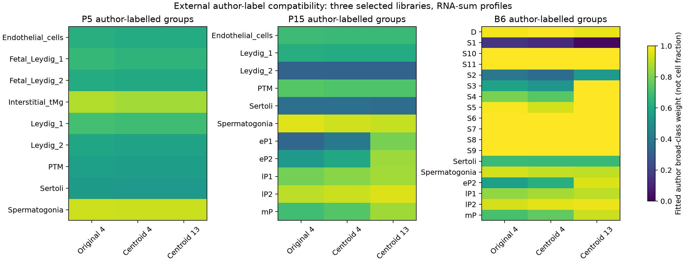

# 作者标签明确的三文库参考适配核查

日期：2026-10-24。本轮独立保存于 `labeled_reference_snapshot/`，不覆盖四组已发布快照。检索是围绕缺失细胞标签的定向补充，不是完整系统检索。

## 为什么选这个来源

[E-MTAB-6946 官方记录](https://www.ebi.ac.uk/biostudies/arrayexpress/studies/E-MTAB-6946)明确说明，`cell_metadata.txt` 的每一行对应 `raw_counts.mtx` 的一个细胞列，包含 `Sample`、`Library`、`Barcode`、`AnnotatedClusters` 和逐细胞 QC 指标；[固定版本作者说明](https://github.com/MarioniLab/Spermatogenesis2018/tree/5d10fe6017651e4cc583d12ba0bac49c51717329)给出配套基因表和读入顺序。本项目只读取资料，不执行或复制作者分析函数。

这补充了前轮 GSE121904 缺少逐细胞作者标签的证据缺口，但没有改变该数据集自身的标签缺失状态。作者的标签来自其转录组分析；它们独立于本项目拟合，不等于独立测量的组织纯度或体内细胞数真值。

## 检索和下载边界

官方接口：`https://www.ebi.ac.uk/biostudies/api/v1/studies/E-MTAB-6946`。固定 accession，不做跨数据库编号换算。读取单个研究的完整文件清单，再按本节范围取文件；不宣称覆盖全部公开睾丸单细胞图谱。

作者旧 `.processed.1.zip` 地址返回 HTTP 404，当前官方原矩阵为 3,012,455,192 字节。首次完整传输因速度不足主动停止，未完成缓存不用于分析。后改为预先固定三个完整正常文库的原矩阵字节窗口：

| 年龄／来源 | 文库 | 原始细胞列范围 | 完整细胞数 |
|---|---|---:|---:|
| 成年 B6，67 天 | do17815 | 1–1,157 | 1,157 |
| P5 | do26386 | 26,381–29,756 | 3,376 |
| P15 | do18195 | 37,706–41,963 | 4,258 |

这是受本轮时间与传输资源限制的三文库子集，不是表达好坏筛选，也不是完整图谱。其余正常文库及所有 Tc0/Tc1 样本未纳入本轮表达诊断。Tc0 为作者转染色体实验的同窝背景对照，不能仅因不带人染色体就当成正常 B6。

使用 HTTP Range 的精确列转换边界，而非按文件百分比估计后直接截断。服务器必须返回正确 `206`、`Content-Range` 和同一强 ETag，随后逐项核对所选完整文库的非零项数、全部细胞计数总量和检测基因数。源文件整体 SHA-256 不可用，不宣称核验过完整 3 GB 文件；每个成功窗口及其他输入各自记录大小、SHA-256、精确范围和来源版本。

本地文件下载全部走本机代理，无直连回退。原始文件和未完成缓存留在 Git 忽略目录；机器相关代理地址不写入公开数据清单。

## 分析设计

仅使用 SDRF 明确为 `wild type genotype` 且品系 `C57BL6J` 的已选文库。SDRF 中的多条测序行按来源文库去重，不视作额外动物。排除作者 `Outliers` 标签；文库×作者类型至少 20 个细胞才进入表达诊断。保留完整组清单，不能把低于阈值的组说成生物学缺失。

原混合参考基因组中含人染色体 21 特征。本轮先核对完整输入，再仅保留唯一小鼠 gene ID 对应的唯一 symbol；人基因及所有歧义小鼠 symbol 均排除，不选择“表达较高”或“结果更好”的映射。分别汇总计数求和和等细胞归一化均值，记录映射表达量保留率。

作者标签的大类对应在拟合前固定：`Spermatogonia` → 精原细胞；`eP1/eP2/mP/lP1/lP2/D/MI/MII` → 减数分裂；`S1–S11` → 减数分裂后；明确的八种体细胞标签 → 体细胞。原标签不改名、不重新聚类。尤其 `eP1/eP2` 是早粗线期，不是细线／偶线期。

沿用旧 `original_4`、`centroid_4`、`centroid_13` 参考、已有基因宇宙、统一权重和种子 20261024 的五折留出基因预测，不根据新数据重新选标记。共有基因总量归一化在分折前完成，因此留出基因仍参与总量计算；不称为完全前瞻预测。拟合权重与作者大类标签对照，只检验表达和类别适配，不检验真实体内细胞数比例。

## 已执行结果

三个原矩阵窗口共核对 8,791 个细胞、31,035,165 个非零项；所选细胞的原始总计数及检测基因数均与作者文件一致。排除 588 个作者标记的 Outliers 及 77 个不足 20 细胞的小组后，38 个文库×类型组、8,126 个细胞进入诊断；两种表达权重形成 76 个处理谱，而不是 76 个独立样本。

33226 个输入特征中，排除 351 个人基因特征及歧义映射，得到 32,816 个唯一小鼠 symbol。各组唯一小鼠表达量保留率为 99.81%–99.99%；与旧参考共有 11,856 个基因，共有基因覆盖各组已映射表达量的 76.00%–92.37%。后续归一化只在共有基因上进行，这个受限基因宇宙也限制结果推广。

下表只列计数求和这一表达目标的描述性结果。匹配数指最大拟合大类与作者大类一致；不是测得的细胞比例准确率。另一权重方式见快照，不能当重复验证。

| 文库 | 类型组数 | 原四类匹配 | 同表四类匹配 | 13 成分匹配 | 同表四类／13 成分的留出 log2 RMSE 中位数 |
|---|---:|---:|---:|---:|---:|
| 成年 B6 | 18 | 16 | 16 | 17 | 1.544／1.252 |
| P15 | 11 | 8 | 8 | 9 | 1.909／1.643 |
| P5 | 9 | 9 | 9 | 9 | 2.520／2.520 |

细分参考改善了成年、P15 的该表达预测指标及部分类型适配，但成年 S1 仍以减数分裂大类为最大权重，P15 的 Leydig_2、Sertoli 仍以精原细胞为最大权重。P5 虽九组最大大类均匹配，表达重建误差仍较高；“大类匹配”不能代替参考谱完全兼容。



## 早期减数分裂标签：找到来源，但仍有覆盖限制

[原研究](https://doi.org/10.1038/s41467-019-09182-1)指出，CellRanger 分支漏采低转录复杂度的细线／偶线期细胞，另用 EmptyDrops 分支恢复。因而，即使 P15 的粗线期组适配良好，也不能据此宣布前轮 Cnot4 LZ 失配已解决。

本轮已另外下载并核对 12,219,948 字节的 EmptyDrops 作者标注文件，**未下载或处理其表达矩阵**。该公开标注有 68,937 行，其中 P15 为 13,168 行；`P15Clusters` 明确提供 `Leptotene` 907 个、`Zygotene` 938 个。`AnnotatedClusters=NewCell` 的 9,681 个 P15 细胞不能整体解释为 LZ。

两个公开处理分支的细胞集合不是严格包含关系：P15 的 4,258 个 CellRanger 条形码中，3,487 个出现在 EmptyDrops 标注，771 个不在；EmptyDrops 另外有 9,681 个。因此不能用 13,168−4,258 直接报告“新增细胞数”，也不能用论文某处新增数替代这些下载文件的实际对账。

在完成主诊断与上述元数据核查后，另作**事后、独立保存的标注敏感性分析**：按 `Library+Barcode` 把作者的 `P15Clusters` 显式连接到已经缓存的 CellRanger 计数，不替换主分支原标签。其中只有 266 个作者标注的 Zygotene 有已缓存表达（原标签为 eP1 的 263 个、Sertoli 的 2 个、eP2 的 1 个）；Leptotene 仅 13 个，不满足既定至少 20 细胞阈值，不合并凑数、不评分。

| 偶线期重叠子集，计数求和 | 原四类 | 同表四类 | 13 成分 |
|---|---:|---:|---:|
| 最大拟合大类 | 精原细胞 | 精原细胞 | 减数分裂 |
| 减数分裂大类权重 | 0.318 | 0.398 | 0.826 |
| 留出基因 log2 RMSE | 2.047 | 2.083 | 1.746 |

等细胞均值给出相同最大大类方向，具体数值见 `zygotene_overlap_*.csv`。这些只覆盖全部 938 个作者偶线期细胞中的 266 个，遗漏大多数 EmptyDrops-only 低复杂度细胞；不同处理分支标签本身也有变化。结果支持细分参考对这个**已捕获重叠子集**的表达适配更好，不证明全部偶线期、细线期、Cnot4 LZ 或真实细胞数比例已得到解决。

下一步已有明确目标：获取并逐细胞核验 EmptyDrops 的 P15 原始计数，保留完整 Leptotene／Zygotene 标签群，再检查是否仍然重现上述改善；不能按现有有利结果只挑重叠细胞。

三个文库每个年龄只取一份，不能做动物层面的年龄显著性检验，也不能分离年龄、文库、组织制备和作者标签策略的影响。两种权重方式是相同细胞的不同表达目标，不是重复实验。

## 运行和核查

```bash
# 首次取已声明窗口需显式联网；缓存齐全时默认离线
bash envs/python.sh scripts/run_labeled_reference.py --download
bash envs/python.sh scripts/run_labeled_reference.py
bash envs/python.sh scripts/check_labeled_snapshot.py --inputs
bash envs/python.sh scripts/check_labeled_reproduction.py
# 核对原四组已发布成果，不能用新分支替代旧分支核查
bash envs/python.sh scripts/check_project.py --inputs
```

本轮 39 项代码测试通过；新目录复跑核对 14 张表与 4 份来源／设计 JSON 一致（忽略聚合运行耗时），记录见快照 `reproduction.json`。仅从三个冻结原始字节窗口和作者标注重新聚合、连接及拟合，复用冻结参考及本机已安装依赖；不等于完整图谱重处理、首次网络下载重测或空环境安装验证。缺失冻结窗口的下载恢复与不匹配哈希拒收已用模拟传输测试；没有为此删除真实缓存并重复网络下载。完整性检查是文件与源代码指纹检查，不是科学有效性证书。

## 来源与检索流程

- Ernst C, Eling N, Martinez-Jimenez CP, Marioni JC, Odom DT. *Staged developmental mapping and X chromosome transcriptional dynamics during mouse spermatogenesis*. Nature Communications 10, 1251 (2019). [DOI](https://doi.org/10.1038/s41467-019-09182-1)。
- [官方单研究元数据接口](https://www.ebi.ac.uk/biostudies/api/v1/studies/E-MTAB-6946)；[固定作者仓库版本](https://github.com/MarioniLab/Spermatogenesis2018/tree/5d10fe6017651e4cc583d12ba0bac49c51717329)。
- 数据库来源、范围、文件数与完整性留痕采用 database-lookup 流程。技能文献：Kassis T, Agarwal V, He Y, Patel D, Brueckner AM (2026), *Scientific Agent Skills: A Library of Procedural Knowledge for Research Agents*. [arXiv](https://doi.org/10.48550/arXiv.2609.00065)。该文献是工具流程来源，不验证生物结论。
