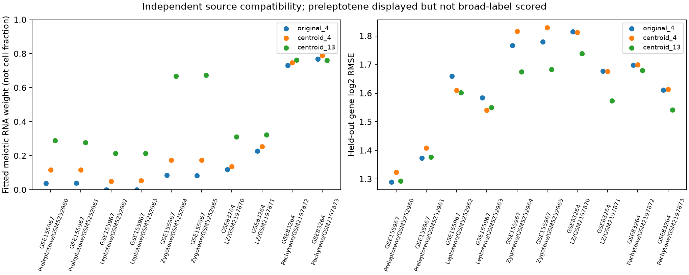

# 独立细线期来源：固定参考适配核查

日期：2026-10-25。本轮承接 [完整 P15 诊断](EMPTYDROPS_P15.md)，追问细线期失配是否也出现在其他研究。只增加独立来源诊断，不改原八队列、不训练新参考、不报告细胞数比例。结果单列 [leptotene_snapshot](../leptotene_snapshot/README.md)。

## 取得了什么

这是四个预先选定来源的定向核查，不是系统综述。检索约束见 [contract](../data/leptotene_contract.json)，原始文件 URL、大小和 SHA-256 见 [输入清单](../data/leptotene_assets.json)。GEO 为主要来源，原论文用于核对年龄、制备和样本角色。

| 来源 | GEO 记录数 | 本轮取得和纳入 | 边界 |
|---|---:|---|---|
| [GSE155967](https://www.ncbi.nlm.nih.gov/geo/query/acc.cgi?acc=GSE155967) | 22 | Preleptotene、Leptotene、Zygotene 各两份，共六份独立计数文件 | 其余 16 条非 RNA-seq 实验记录不纳入；PreL 保留但不作大类标签评分 |
| [GSE83264](https://www.ncbi.nlm.nih.gov/geo/query/acc.cgi?acc=GSE83264) | 20 | 合并 mRNA 表中的混合 LZ、Pachytene 各两份，共四份 | 排除六份全睾丸 mRNA 和十份 small-RNA；混合 LZ 不等于纯细线期 |
| [GSE107644](https://www.ncbi.nlm.nih.gov/geo/query/acc.cgi?acc=GSE107644) | 106 | 取得作者条形码信息表，未接入表达 | 此表只有 raw_file/processed_file/cell/barcode，缺显式细分阶段；不从细胞名称猜标签。不是断言所有公开附属资源均无标签 |
| [GSE109033](https://www.ncbi.nlm.nih.gov/geo/query/acc.cgi?acc=GSE109033) | 8 | 完成 GEO 元数据审查，未接入表达 | 样本标签是富集／未分选群体，不能直接作为逐细胞细线期标签；原论文另提到的 Loupe 注释需单独审核 |

四个来源元数据全部取得，156 条 GEO 样本记录与各系列的 sample_id 清单数目一致；这不是 156 只独立动物。GSE155967 的全部六条 RNA-seq 记录与六个实际文件一一对应，GSE83264 的列名按阶段、重复编号、WT 和 RNA 类型与 GSM 记录明确连接。没有根据表达结果改标签或剔除拟合较差的样本。

Scite 文献插件首次调用出现 transport error，未取得可用文献结果；因此改用官方 GEO 和原论文，不宣称已通过 Scite 核查。GEO 网页部分请求出现验证码，机器可读的官方 FTP 元数据可用；GSE155967 首次代理传输发生 TLS 中断，经同一代理重试成功，未改为直连。所有网络下载使用本地代理，公开清单不包含机器地址。

## 原文来源与身份限制

GSE155967 对应 Zuo 等的 [原论文](https://doi.org/10.1038/s41467-021-26033-0)。论文 RNA-seq 方法明确说明，PreL 来自 10 天未同步小鼠，L 来自 16 天同步小鼠，Z 来自约两周未同步小鼠；每阶段有两份作者称为独立生物样本的材料。同步化为 WIN 18,446 后给予 RA。论文 XML 已保存并冻结于 [来源规格](../data/leptotene_paper_asset.json)。

这不是严格年龄匹配、无处理的阶段对照。逐 RNA 样本 GEO 特征没有显式 genotype 字段，原方法还包含另行开展的 SUN1 W151R 实验；本轮不把这六份样本升级为“逐样本基因型已核实的 WT 真值”。来源报告为分选富集群体，不能当 100% 纯细胞数比例标定材料。没有由两份样本反推精确动物数或是否混池。

GSE83264 的 GSM 记录明确注明 WT、RNA、重复编号及 STA-PUT 富集 LZ／粗线期，来源约为 70–80 天成年小鼠；使用 mm9。GSE155967 为 mm10。二者为不同来源与制备，不能把不同研究的误差高低解释为阶段本身的难易程度，更不能估计同步化处理的因果效应。

## 固定分析

GSE155967 为无表头的 Ensembl gene ID / HTSeq count 两列表；GSE83264 是 symbol / count 合并表。所有值须为有限、非负整数，重复或缺失 gene ID 停止。两者的 `__no_feature`、`__not_aligned` 等 HTSeq 统计行从基因计数和覆盖率分母中排除，另存审计，不作为基因表达。

Ensembl 映射使用前轮已冻结、已核对哈希的作者 `genes.tsv`：只保留唯一小鼠 ID 对应的唯一小鼠 symbol，所有歧义 symbol 排除，不按表达高低挑映射，也不静默删版本号。未映射的新注释 ID 明确记录为损失。GSE83264 直接保留其唯一 symbol，不作表达导向别名替换。

全部十份处理谱和三个旧参考共用 **11,654 个基因**。GSE155967 的唯一 symbol 映射保留基因计数的 99.19%–99.49%，共同参考基因覆盖已映射表达的 91.65%–93.17%；GSE83264 为原 symbol 表，参考共同基因覆盖基因计数的 87.05%–89.49%。覆盖率不包括 HTSeq 统计行，也不等于参考准确率。

继续使用原三套参考、原完整参考基因宇宙上的种子 20261024 五折，以及同表四类均值加一后平方根倒数的权重。不选新标记，不重训参考。共有基因总量在分折前归一化，留出基因参与分母，因此不能称完全前瞻预测。不同来源的全长 bulk counts 与原 3′ UMI 参考之间可能存在基因长度、扩增和文库制备差异；没有可核验长度时不假装已经校正，也不据此归因于单一生物机制。

前细线期处于过渡位置，本轮只展示其拟合权重与表达误差，**不把它预先强判成精原或减数分裂真值**。其余八份按作者来源阶段作大类一致性描述。最大权重大类不是经过校准的分类器，RNA 系数不是细胞数比例。

## 已运行结果

### 分开的 L / Z：第二来源仍显示细线期适配不足

以下每行均使用相同基因与权重；“减数权重”为 RNA 拟合权重，不是细胞百分比。

| 来源样本 | 同表四类减数权重 | 13 成分减数权重 | 13 成分最大大类 | 留出 log2 RMSE，四类／13 成分 |
|---|---:|---:|---|---:|
| L1，GSM5252962 | 0.050 | 0.214 | 精原细胞 | 1.610／1.602 |
| L2，GSM5252963 | 0.054 | 0.214 | 精原细胞 | 1.540／1.550 |
| Z1，GSM5252964 | 0.176 | 0.668 | 减数分裂 | 1.816／1.675 |
| Z2，GSM5252965 | 0.174 | 0.675 | 减数分裂 | 1.830／1.684 |

两份细线期均仍主要拟合为精原细胞；其中一份的细分参考留出误差还略增，不能概括为“细分后全部改善”。两份偶线期则最大大类转为减数分裂，且误差下降。该模式与前轮 P15 诊断方向相符，但没有排除年龄、同步化、分选纯度、技术或基因集合的混杂。不能称已找到可直接用于校准的细线期参考。

两份细线期在共有基因上的 log2 CPM Spearman 相关为 0.992，偶线期为 0.998，前细线期为 0.993。只是作者报告两份样本之间的表达一致性，不能以 11,654 个基因当作动物重复计算显著性。

### 混合 LZ 对照也没有全部解决

GSE83264 的两个混合 LZ 样本在 13 成分参考下，减数权重约为 0.311／0.324，最大大类仍为减数分裂后；两份粗线期约为 0.762／0.762，最大大类为减数分裂。保持作者分组，不根据生殖后期基因表达重贴标签，也不把混合 LZ 失配直接归因于细线期成分或污染。

八份可评分谱中，原四类／同表四类／13 成分的大类匹配数为 2/8、2/8、4/8。该比值不是分类准确率；它主要指出已有参考在这些外部表达谱上的兼容性仍有局限。13 成分加权条件数为 37.53，同表四类为 2.63，细分模型的可辨识性限制仍需保留。



这些结果把问题从“P15 单个细胞调用分支中的异常”推进为“另一阶段明确来源中也观察到细线期适配不足”，但尚不能区分具体原因。下一步应为细线期候选参考预先指定独立构建／验证来源，并核查不同计数技术的影响；不能在这批已用于诊断的数据上训练后，再把同批数据称为独立验证。原全睾丸共性分析可以继续，但组成解释仍应保持探索性，不把残差称为共享分子机制。

## 复现和验证边界

需要原项目中已冻结的三个参考及前轮基因映射文件。联网恢复本轮来源时仍使用项目代理：

```bash
bash envs/python.sh scripts/run_leptotene.py --download
```

缓存齐备后的离线运行、独立目录重跑及快照检查：

```bash
bash envs/python.sh scripts/run_leptotene.py
bash envs/python.sh scripts/check_leptotene_reproduction.py
bash envs/python.sh scripts/export_leptotene.py
bash envs/python.sh scripts/check_leptotene.py --inputs
```

新目录重跑检查完整计数处理和拟合，不复用旧结果表；复用已安装依赖和冻结原始输入，不是空依赖环境安装或再次网络下载验证。缺失输入恢复与错误缓存拒收使用模拟传输测试，没有删除真实缓存来重复下载。文件完整性不替代科学有效性判断。

本轮已实际完成新目录重跑：十张表（含完整共有基因计数矩阵）与两份映射／设计 JSON 一致，记录见快照 `reproduction.json`。61 项单元测试通过；新快照 14 个文件、18 项代码／规格指纹及 17 份原始来源／参考／映射／论文输入检查通过，原六组快照的完整性检查也均通过。新结果保留本地，本轮未提交或推送 GitHub。

## 参考文献与流程来源

- Zuo W, Chen G, Gao Z, et al. (2021). *Stage-resolved Hi-C analyses reveal meiotic chromosome organizational features influencing homolog alignment*. Nature Communications, 12, 5827. [DOI](https://doi.org/10.1038/s41467-021-26033-0)。
- 四个 GEO 研究的官方 accession 见上表；实际采用的十个 GSM、URL 与文件校验值见输入清单及快照 `sample_evidence.csv`。本轮不依据综述的二手数据集表判定样本身份。
- 数据库查找与来源留痕使用 database-lookup 流程，相关技能方法文献已加入本记录：Kassis T, Agarwal V, He Y, Patel D, Brueckner AM (2026). *Scientific Agent Skills: A Library of Procedural Knowledge for Research Agents*. [arXiv DOI](https://doi.org/10.48550/arXiv.2609.00065)。这是工具流程来源，不验证生物学结论。
