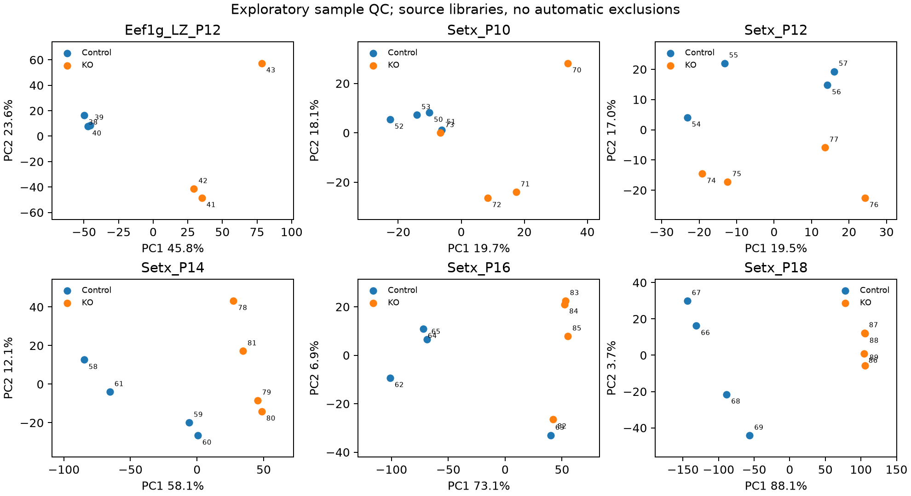
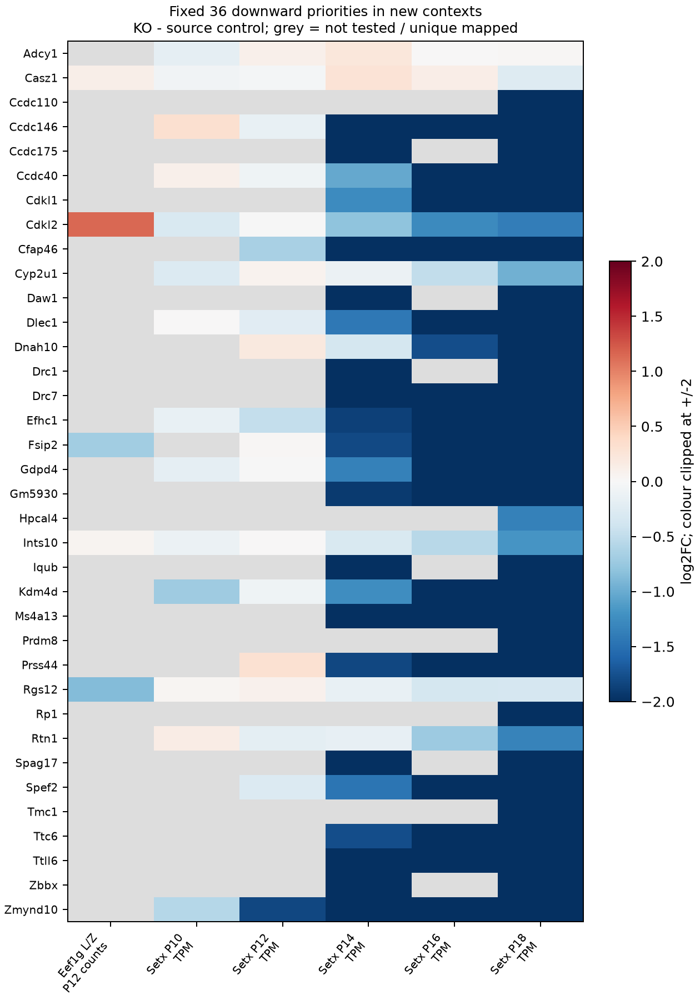

# 新数据核查：Setx 发育序列与 Eef1g 分选细胞

日期：2026-10-26。新增资料单列为探索分支，不改变[四遗传单位主检验](REPLICABILITY.md)的基因宇宙、模型票数或零发现结论。本轮读取了 40 份 Setx 全睾丸表达谱及 6 份 Eef1g 分选细胞表达谱；这不是新增 46 个已核实独立动物，也不是把六个年龄／来源对比称为六种遗传模型。

## 检索与来源核查

采用 NCBI GEO 的 `gds` E-utilities 接口，固定小鼠及 GSE 系列过滤，按两条文本查询定向寻找减数分裂／生精阻滞和若干候选遗传模型。2026-10-26 检索分别返回 37 和 28 个 UID，均完整取回，去重后 61 个系列。通过 ESummary 的 accession 字段解析 UID，没有用数值加减猜 GSE。两次搜索及两批摘要请求共 4 次 API 请求；再读取 12 份预先指定候选的 family SOFT。文本检索会命中卵巢、ChIP、IP 和单细胞研究，不能直接作为纳入条件。

所有文件下载从首次尝试即经过用户本地代理，没有改用直连。请求 URL、参数、时间、计数对账及响应 SHA-256 见 [query_audit.json](../new_models_snapshot/query_audit.json)；61 系列清单见 [search_inventory.csv](../new_models_snapshot/search_inventory.csv)，12 个样本级核查决定见 [metadata_review.csv](../new_models_snapshot/metadata_review.csv)。这是定向筛查，不是完整系统综述；其余 49 个系列没有完成本轮样本级核查。

| 重点候选 | 来源核查结果 |
|---|---|
| GSE224875，Setx | P10/12/14/16/18 全睾丸，来源各 WT4/KO4；附件有 TPM、RSEM 估计计数及有效长度，本轮只作 TPM 分年龄敏感性 |
| GSE307441，Eef1g | P12 分选细线／偶线期，WT3/cKO3；整数基因计数通过核查，单列细胞群表达背景 |
| GSE120994，CFP1 | 题名涉及减数分裂，但实际是 ChIP-seq，不能作六份 RNA-seq |
| GSE93566，Ythdc2 | P12/P14 总 RNA 各 2/2，另有 m6A-IP，不能把 IP 加为表达重复；附件描述为差异结果 |
| GSE108044，Ythdc2 | P8/P9/P10、配对窝别及部分 HET 对照，P10 仅两对；不能简单改成 WT 对照三年龄独立模型 |
| GSE222283、GSE196427 | 有合适年龄的整体睾丸记录，但相关处理表明确为归一化计数；控制组、等位基因及其他模态需分开 |
| GSE175734，Tardbp/TDP43 | P12 3/3，Salmon/tximport 估计计数；WT 全在批次2，KO仅一份在批次2，需保留设计功效限制；本轮未下载／拟合 |
| GSE246296、GSE190980、GSE102346、GSE98085 | 分选、RNA/Ribo、HET、结合／IP或混合模态；不能仅凭系列标题及总样本数纳入全睾丸原始计数主分析 |

## 文件身份与表达单位

两份新处理文件总计 **50,808,989 字节**，URL 与 SHA-256 见 [new_assets.json](../new_models_snapshot/new_assets.json)。原始文件留在 Git 忽略的 `data/raw/replicability_discovery/`。

**Setx：** [GSE224875](https://www.ncbi.nlm.nih.gov/geo/query/acc.cgi?acc=GSE224875) 的 TAR 有 80 个成员：40 份 GRCm38 基因 RSEM 表及40份独立 piRNA 表。通过每个成员的 GSM 与来源标题／基因型逐一对账，恰好保留每个 GSM 的一份基因表，排除对应 piRNA 表；没有解包到任意文件路径或混合两套表达。

每份基因表均为 55,401 行，基因编号与顺序一致，保存 `expected_count`、`effective_length`、`TPM` 三份独立矩阵。TPM 总和为 999,998.75–1,000,001.56，符合两位小数舍入后的百万尺度。估计计数有约 4.61%–5.91% 非整数，符合其 RSEM 估计身份；没有四舍五入冒充原始整数计数，也没有把 TPM 喂入计数流程。40 个 TPM 向量无完全相同重复。成员 SHA、总量与非整数比例见 [Setx_archive_audit.csv](../new_models_snapshot/Setx_archive_audit.csv)。

**Eef1g：** [GSE307441](https://www.ncbi.nlm.nih.gov/geo/query/acc.cgi?acc=GSE307441) 为 54,532 行、含注释的 16 列，只有明确的 `Ee_con1–3`、`Ee_cKO1–3` 六列作为计数。六列均为有限非负整数；gene_length、坐标等数值注释不算样本。以控制／cKO及重复编号对应 GEO 的 GSM9224238–GSM9224243，来源为 P12 FACS L/Z。原研究对应 [Xu et al., Advanced Science 2026](https://doi.org/10.1002/advs.76264)，文章确认分选阶段、取样期及 RNA-seq 的 n=3；本轮仍未核实每库动物数、是否合池及隐藏批次，不能仅用 rep1–3 证明动物独立性。

两来源的完整 GSM、来源标题和拟合分组见 [sample_evidence.csv](../new_models_snapshot/sample_evidence.csv)。Setx 的取样期来自样本标题，来源缺少匹配论文／具体等位基因与相应时点组织学的充分链接，不能只凭公共条目把各时点称作已确认同一阻滞分期。

## 实际运行的方法

Eef1g 使用原 gene_id 计数，独立 filterByExpr、TMM、voom/limma，效应为 cKO−来源控制。Setx 各年龄分别在原 Ensembl 基因编号上过滤：至少较小组大小的样本有 TPM≥1，完整拟合为至少4份；随后 `log2(TPM+0.5)`、limma trend/robust，效应为 KO−来源 WT。没有合并不同年龄表达矩阵作一次基因型拟合，也没有把同一 Setx 的五年龄加为五个遗传票数。

全部 6 次 Eef1g 及 40 次 Setx 逐样本删除均重新过滤和拟合，删除后较小组为2或3。Setx 另固定检查伪计数 0.1 和1，共十个替代拟合。留一范围不是置信区间，伪计数变化也不是独立生物重复。不同年龄单独拟合的差异不能直接当作基因型×年龄交互的显著性检验。

拟合保留所有符合表达过滤的原始 gene_id，未先丢掉未映射计数／TPM。跨来源比较才用唯一 symbol：Eef1g 沿用源文件 gene_name；Setx 使用本机 org.Mm.eg.db 3.23.0 单值 Ensembl 映射，并在每次拟合内排除所有重复 symbol，不挑效应较大的编号。Setx 命名 symbol 可覆盖约 92.47%–94.04% 的原 TPM 质量、97.05%–97.61% 的估计计数质量，说明注释损失仍需保留；原始全特征拟合没有因此损失这些表达。逐样本记录见 [source_mapping_mass.csv](../new_models_snapshot/source_mapping_mass.csv)。

完整模型共受检：Eef1g 8,513；Setx P10/12/14/16/18 分别 16,055、16,283、16,733、16,482、17,363 个基因特征。模型原始及调整 P 值保存在本地 `results/new_models/conditional_model_statistics.csv.gz`，依赖来源库独立性、均值方差及模型假设；没有据这些值宣布新的确认性共享机制或候选子表 FDR。此处不是作者 DESeq2 显著性结果的逐一复现。



PCA 使用本轮 voom 或 log TPM 表达；点旁为 GSM 末两位，仅帮助定位原表。未根据 PCA 自动删样，也没有从分离程度推断效应的因果来源。

## 固定候选在新来源中的表现

沿用主分支已经固定的全部 105 个描述性候选和其中 36 个下调稳定优先候选，不按新来源结果重新挑选。630 个候选／对比组合全部保留；未受检、未映射和歧义 symbol 保留为缺失，不补零。

| 新来源 | 36 个中受检且唯一映射 | 同向 ≥1.5 倍 | 完整拟合及全部留一仍 ≥1.5 倍 | 再同时保留两种伪计数 |
|---|---:|---:|---:|---:|
| Eef1g L/Z P12 counts | 5/36 | 2/5 | 0/5 | 不适用 |
| Setx P10 TPM | 14/36 | 1/14 | 1/14 | 0/14 |
| Setx P12 TPM | 19/36 | 2/19 | 1/19 | 1/19 |
| Setx P14 TPM | 31/36 | 24/31 | 24/31 | 24/31 |
| Setx P16 TPM | 25/36 | 20/25 | 19/25 | 19/25 |
| Setx P18 TPM | 36/36 | 33/36 | 33/36 | 33/36 |

后三列分母是完整拟合中可比较的基因；缺任一删除变体便不能通过稳定性条件。全部 105 候选的可比较数依次为22、50、56、83、70、101；同时保留完整拟合及所有删除条件的1.5倍基因数为0、2、1、50、50、90。完整分母与方向见 [context_summary.csv](../new_models_snapshot/context_summary.csv)，逐基因效应见 [candidate_context.csv](../new_models_snapshot/candidate_context.csv)。



图按基因名字母顺序保留全部 36 个，灰色为未受检／不能唯一映射，颜色在±2截断，CSV保留原值。Setx 后期的方向延续是值得后续验证的观察，但不能区分细胞数量、阶段构成、细胞内调控和技术因素。Eef1g 仅覆盖5/36，不能用0/5宣布共性不存在。两个来源都没有校准此前失配的反卷积参考，也没有证明36个基因为纯粹细胞内机制。

## 复现与成果边界

35 份冻结输入包括两个新处理文件、精确查询响应、12份原始SOFT及逐字段对账的元数据、固定旧候选表。所有查询计数与文件身份先核对，再绑定 SHA-256；不通过重写清单掩盖输入改变。运行入口：

```bash
# 已有冻结输入，不主动联网
bash envs/python.sh scripts/run_new_models.py
# 复制原始处理文件和固定旧候选，在新目录重处理／重拟合
bash envs/python.sh scripts/check_new_models_reproduction.py
# 快照、绑定代码／规格及本地输入完整性
bash envs/python.sh scripts/check_new_models.py --inputs
```

新目录复跑比较 **14 张表、2 份 JSON 和2张图一致**，包括本地大表中的全部拟合、46次留一和十个伪计数替代；11张小表、两份设计、两张图及检索留痕发布到 `new_models_snapshot/`。87项全套代码测试通过，新增覆盖注释列误当样本、非整数计数、额外库静默丢失、piRNA混入／成员缺失／路径，以及symbol歧义。实测复用现有 Python 3.14.7、R 4.6.1、limma 3.68.5、edgeR 4.10.6与 org.Mm.eg.db 3.23.0；不是空依赖安装、重新比对原始reads、重新联网下载或动物独立性验证。

本轮成果使项目新增了可重算的时间序列表达背景和分选细胞背景，也明确了后续需要核实的组织学、等位基因、动物与批次问题。Setx可进一步设计年龄交互与RSEM长度／计数处理敏感性；在这些工作真正执行前，不把它们写成已完成分析。

检索采用 database-lookup 1.8 技能流程；软件／流程引用为 [Kassis, T.; Agarwal, V.; He, Y.; Patel, D.; Brueckner, A. M. (2026), Scientific Agent Skills: A Library of Procedural Knowledge for Research Agents](https://doi.org/10.48550/arXiv.2609.00065)。已核对当前 arXiv 记录，该引用说明流程来源，不验证统计或生物结论。
