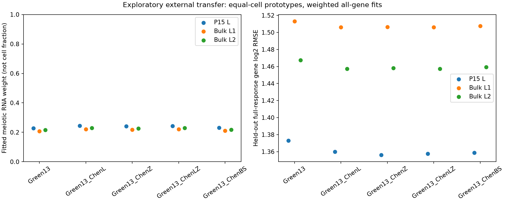
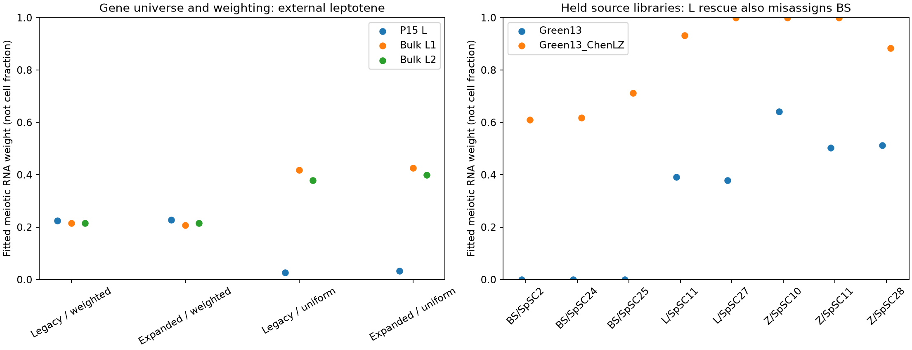

# 细线期失配：基因集合、独立 UMI 来源与参考转移边界

日期：2026-10-25。本轮承接 [独立细线期来源诊断](LEPTOTENE_FOLLOWUP.md)。结果支持继续研究早期减数分裂参考的适配问题，但**不支持直接把新增细线期参考用于可靠的细胞比例解释**。扩大基因集合没有自动解决失配；新的同来源文库留出检查还暴露了精原细胞被误分到减数分裂大类的问题。

原八队列基线及前七组快照保持不变。本轮为单列探索分支，成果在 [reference_limits_snapshot](../reference_limits_snapshot/README.md)，原始矩阵、完整阶段表达谱与候选参考文件留在忽略目录中。

## 新取得的可复用数据

来源是 Chen 等的 [GSE107644](https://www.ncbi.nlm.nih.gov/geo/query/acc.cgi?acc=GSE107644)及其 [原论文](https://doi.org/10.1038/s41422-018-0074-y)。前轮只有原始条形码表，缺少显式阶段；本轮取得原论文 Table S1 / S2，直接连接作者细胞阶段、Wild-type QC 表与官方 UMI 矩阵，不从表达或细胞名称猜阶段。

34 个完整 UMI 文库中有 1,204 个矩阵细胞。作者 S2 保留的 1,136 个细胞全部找到矩阵身份，且其总 UMI 和检测基因数逐一与作者 QC 表一致；其余 68 个矩阵细胞不作为已获得 S2 阶段标签的细胞使用。每个文库具有相同的 23,154 个唯一基因 symbol，未对缺失特征作零填充。二十个作者阶段形成 40 份表达处理谱：计数求和与等细胞归一化均值，两种视角不是重复实验。

其中 L（细线期）49 个细胞，来自 SpSC11 的 10 个和 SpSC27 的 39 个；Z（偶线期）65 个，来自三个处理文库；BS（S 期 B 型精原细胞）67 个，来自三个处理文库。前细线期 G1/ePL/mPL/lPL 保留为过渡阶段，不强行指定精原或减数分裂真值。Sox30-cKO、Spo11-cKO 另外两张 QC 表不纳入。

这里的 Wild-type 是作者表的分组。实验使用同步化和荧光标记生殖细胞，不能视为未经处理的正常全睾丸无偏抽样；文库、细胞或阶段数均不是独立动物数。

### 43 个细胞 ID 的明确别名核对

S1/S2 写作 `SpSC24_In_sc.*`、`SpSC34_In_sc.*`，矩阵与条形码表对应写作 `SpSC24_ln_sc.*`、`SpSC34_ln_sc.*`，存在大写 I / 小写 l 的字形差异。仅对这两个明确前缀允许别名，要求文库、细胞编号后缀和唯一条形码映射一致，并且逐细胞 UMI 总数及检测基因数同时匹配。43 个别名全部满足这些核对；两个 ID、别名标记和 QC 数值均保留在快照 `chen_cell_QC.csv.gz`。没有进行一般性的模糊名称替换。

## 取数和分析约束

取数对象在 [分析约束](../data/reference_limits_contract.json) 中记录。出版社附件直链遇到 TLS 中断，部分 PMC 附件响应为 HTML，均未当作工作簿分析。最终通过文档明确的 [Europe PMC supplementaryFiles 接口](https://europepmc.org/RestfulWebService)取得 32,477,145 字节 ZIP，只读取其中签名、大小和来源成员均核对过的 S1/S2 工作簿；另外下载官方 GEO 的 34 个 UMI 矩阵。出版社另一公开内容域名随后也返回了有效表格，但分析统一绑定 ZIP 中的冻结副本。

这是一个研究的预选完整文库及两份作者表，不是系统性检索全部睾丸图谱，也不是逐条请求数万基因。所有下载从首次尝试起走本地代理，没有直连回退。失败的 HTML 响应保留在忽略目录，未进入输入清单。可用输入的 URL、大小、SHA-256 和工作簿 ZIP 成员见 [Chen 来源清单](../data/chen_umi_assets.json)；原有输入和本轮辅助原文归档见 [66 份输入清单](../data/reference_limits_inputs.json)，旧分选谱另有 [七份输入清单](../data/reference_limits_sorted_inputs.json)。

本轮没有执行原作者代码。另一个定向候选原文 PMC10541148 的 XML 仅作资料可用性审计，没有接入其表达数据，不计为新增验证研究。

## 先检验技术设定，不按结果挑基因

旧 13 成分参考起初受一份早期外部分选表的可用基因限制。原 Green 表有 24,475 行，其中 27 行被 Excel 转为非字符串日期等内容，仍按旧规则排除、不猜回基因名，得到 24,448 个有效基因。四类 pooled 参考另从缓存的原类别计数和元数据重新构建；重新限制到原 11,874 个基因并归一化后，三套旧参考均复现一致。

本轮在所有 80 份处理谱上使用相同交集：30 份完整 P15 类型谱、此前两来源的十份分选 RNA 谱、40 份新 Chen 阶段谱。旧参考基因交集为 11,632 个，扩展后为 **16,929 个**。交集由文件可用性决定，不根据 L/Z 拟合好坏选取。

比较了旧／扩展基因集合、原平方根倒数权重／统一权重，以及三个固定参考。旧基因保持种子 20261024 的五折，新参考基因按排序用种子 20261025 追加折数，不因加入新基因重新划分旧基因。

对 mm10 的 GSE155967 bulk counts 另做长度敏感性：用已冻结的 Ensembl 79 GRCm38 GTF 计算同一基因全部外显子的并集长度，重复转录本重叠外显子不重复计数。未将其冒称为原作者 GTF、有效转录本长度或严格 TPM；也未给 UMI 数据除以基因长度，未把 mm10 长度直接用于 mm9 的 GSE83264。长度覆盖的原始计数和除长度计数使用完全相同的基因、参考、权重和折数。

不同基因集合及计数变换会改变总量归一化和响应值，跨集合 RMSE 不能视为同一响应尺度上的简单优劣。归一化在分折前完成，留出基因仍参与分母；这些是表达诊断，不是完全前瞻的缺失基因实验。基因折数不是生物学重复。

结果是：在这些预先列明的旧参考技术变体中，P15 完整细线期及 GSE155967 两份细线期的 13 成分最大大类仍为精原细胞。通用长度处理未自动消除这一失配，**不等于排除了技术差异的作用**。

## 新增参考谱：局部改善不等于可用校准

用 Chen 的明确 L、Z、BS 阶段完整均值建立五个候选：原 Green13、加 L、加 Z、加 L+Z、加 BS。BS 是同来源精原细胞额外列对照。分别保留等细胞均值与 RNA 求和原型、两种基因权重，未对外部目标挑标记或调参。

另作一个固定的训练来源内特征分支：每个 Chen 阶段选源 CPM≥10 的前 200 个相对特异基因，再加 Green 体细胞的前 200 个，按 symbol 确定同分次序。二十个阶段及体细胞共选出 3,358 个唯一基因，响应交集中有 2,971 个；五个候选使用同一面板。基因排序不使用外部目标表达或标签。拟合只用训练折的面板基因，但预测误差仍在完整响应基因集合的留出折上计算，不把面板内误差冒充全基因预测误差。

候选构建只使用 Chen 来源；候选外部评价排除全部 Chen 处理谱，保留此前 40 份 P15／分选处理谱。由于此前已查看这些来源的失配，这仍是探索性跨研究转移，不能称未经接触的最终独立验证。

主要设定为等细胞原型、原平方根倒数权重、全部共有基因：

| 外部细线期目标 | 原 Green13 减数 RNA 权重 | 加 Chen L+Z 后 | 最大大类是否改善 |
|---|---:|---:|---|
| P15，907 个细胞，计数求和 | 0.228 | 0.243 | 仍为精原细胞 |
| GSE155967 L1 | 0.208 | 0.220 | 仍为精原细胞 |
| GSE155967 L2 | 0.215 | 0.229 | 仍为精原细胞 |

完整 P15 类型组的大类匹配数在这五个候选之间没有提高：计数求和均为 13/15，等细胞均值均为 14/15；这些比值只是标签一致性描述，不是测得的分类准确率。

保留有利的敏感性结果：在**统一权重、全基因拟合**下，部分加 L 或 Z 的候选能使两份 bulk L 的最大大类转为减数分裂，权重约 0.53–0.57；但 P15 细线期在本轮全部候选处理变体中仍以精原细胞为最大大类，且来源内特征面板没有给出稳定、通用的纠正。不选最有利分支来宣布校准完成。

主要设定下，加权条件数从原 Green13 的 35.41 增至加 L+Z 后的 73.92。条件数本身不是科学有效性判据，但说明新增相关分量并非没有可辨识性代价。



## 来源文库留出揭示了精原细胞假阳性

以来源处理文库为单位同时从 L/Z 原型中删除该文库，不让目标细胞出现在该变体原型里。此阶段使用全基因和固定旧参考权重，不用包含留出来源的特征面板。两种 L/Z 原型为相同来源不同细胞的表达均值；文库并未核实为独立动物。

两组留出的 L 在新增 L+Z 原型后，最大大类均变为减数分裂；但三个留出的 BS 精原细胞组也全部被主要拟合为减数分裂，减数 RNA 权重约为 0.610、0.617、0.713。原参考在三组 BS 中均以精原细胞为最大大类。八个来源留出组的匹配数从 6/8 降为 5/8，即使表达预测误差降低，也不能据此宣布类型区分更准确。

其中删除 SpSC27 后，L 原型只剩 SpSC11 的十个细胞，单独标为低细胞数敏感性，不称生产参考。留出文库变体之间共享来源和外部目标，其范围不是置信区间。



## 回查原有 20 份分选资料

另用原来已核对的 GSE158471、GSE232415、GSE290629 全部二十份分选 WT 表达谱，独立成支比较固定候选；两份 preL 仍不评分。六份原始／预处理输入先与旧 `reference_audit_snapshot/design.json` 的哈希核对，不重新挑选样本。此分支有 14,674 个共有基因，不能把其 RMSE 与上节 16,929 基因分支直接相减。

主要设定下，五个候选的 18 份可评分谱匹配数均为 16/18。Cnot4 的两份混合 LZ 在加 L+Z 后，减数权重从约 0.010／0.035 增至 0.125／0.148，但最大大类仍是精原细胞；其 PD 两份的留出 log2 RMSE 反而从 1.409／1.399 增至 1.693／1.734。不能只报告 LZ 的局部误差下降或减数权重上升而略去这些代价。

## 对项目的实际影响

本轮建立了可复用、逐细胞对账的阶段 UMI 数据资源，并排查了几条直接修复路线。结果不支持现在就把任一候选替换为已校准生产参考，也不支持可靠细胞数比例、组成贡献因果百分比或把残差直接解释为共享机制。

原有分平台表达效应分析仍可继续。组成分支需要把“表达拟合较好”和“能区分邻近细胞类型”作为两项不同要求；后续参考构建应同时包含阶段邻近的精原／前细线期对照，预先区分构建来源与新的验证来源，再检验跨研究适配。不能用本轮已参与探索的数据再次充当未经接触的最终验证。

## 运行与验证范围

需要此前已完成的原参考、缓存类别计数、P15 处理谱和已有分选资料。新来源缺失时可经项目代理恢复：

```bash
bash envs/python.sh scripts/run_reference_limits.py --download
```

缓存齐备时默认离线；以下命令依次重算、重跑和导出：

```bash
bash envs/python.sh scripts/run_reference_limits.py
bash envs/python.sh scripts/check_reference_limits_reproduction.py
bash envs/python.sh scripts/export_reference_limits.py
bash envs/python.sh scripts/check_reference_limits.py --inputs
```

新目录从原 34 个 UMI 矩阵与作者表重新聚合，重算技术变体、候选转移、来源文库留出与旧分选资料复查；P15 处理谱、原参考类别计数及既有分选缓存作为已冻结输入复用。不是整个八队列主项目从头重跑、空环境安装或再次网络传输验证。精简快照不含大型完整阶段矩阵，但保留逐细胞 QC、全部诊断结果、排除清单、条件数及源代码／规格指纹。文件完整性不替代科学有效性判断。

已实际完成新目录离线重跑，**38 张表和六份来源／设计 JSON 一致**，包括完整 Chen 阶段／分文库表达矩阵与逐细胞 QC；见快照 `reproduction.json`。72 项单元测试通过，覆盖外显子并集、旧折数保留、来源限定特征排序、候选分量质量守恒、文库均值重组、明确细胞 ID 别名、非法 UMI 和来源恢复等。缺失派生工作簿可从冻结 ZIP 离线恢复；已有源文件不符时拒收，不自动覆盖。

新快照 46 个文件、28 项代码／规格指纹及 86 项去重后的原始／既有预处理／新派生原型输入检查通过，原七组快照的完整性检查也均通过。两张图已作视觉核查；表格与 JSON 的复现不等于声明所有图片二进制逐字节相同。本轮成果保留本地，未提交或推送 GitHub。

## 来源和流程文献

- Chen Y, Zheng Y, Gao Y, et al. (2018). *Single-cell RNA-seq uncovers dynamic processes and critical regulators in mouse spermatogenesis*. Cell Research, 28, 879–896. [DOI](https://doi.org/10.1038/s41422-018-0074-y)。作者 Table S1/S2 和 GSE107644 为本轮新细胞来源。
- 原参考来源 Green 等及原十份／二十份分选资料的出处见前轮文档、本轮输入清单和样本证据表；本轮不把混合 LZ 当纯 L，也不消除 FPKM、bulk counts 和 UMI 的制备差异。
- [Ensembl GTF 资料说明](https://www.ensembl.org/info/website/upload/gff.html)、[GENCODE 字段说明](https://www.gencodegenes.org/pages/data_format.html)及冻结 GRCm38.79 文件用于外显子并集长度的显式敏感性处理，不宣称重现原始注释。
- 数据库检索使用 database-lookup 技能，方法文献已加入本记录：Kassis T, Agarwal V, He Y, Patel D, Brueckner AM (2026). *Scientific Agent Skills: A Library of Procedural Knowledge for Research Agents*. [arXiv DOI](https://doi.org/10.48550/arXiv.2609.00065)。它是检索流程来源，不验证本项目生物学结论。
