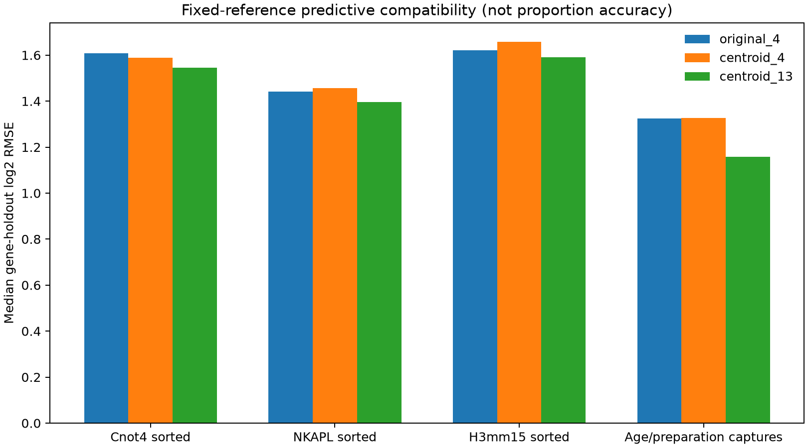

# 发育期来源核查与固定参考谱转移诊断

日期：2026-10-24。本轮单独保存于 `reference_audit_snapshot/`，不覆盖原八队列、四对比扩展或 Lrh1 后续分析。没有训练新的年龄特异细胞类型参考，也不报告已验证的细胞数比例。

## 数据与标签证据

通过代理获取 [GSE121904](https://www.ncbi.nlm.nih.gov/geo/query/acc.cgi?acc=GSE121904) 的官方 SOFT、处理矩阵及原作者仓库中的样本表、说明、许可和两个脚本，共 7 个文件、53,870,223 字节。固定作者仓库版本为 `649d8aa4976915c834f195b79eff161cd10c38c6`。URL、大小和 SHA-256 见 [输入清单](../data/age_reference_assets.json)。这是定向来源核查，不是完整系统检索；未执行原作者代码。

矩阵有 27,998 个基因、15,882 个细胞，条形码前缀与 GEO 的 8 个捕获文库、作者样本表逐一对应。作者表采用 ISO strict OOXML，普通 Excel 读取器未识别到工作表；本轮读取其固定 XML 数据表，没有修改源文件。其 `Conditions` 为文库时期分组，不是逐细胞类型标签。

| 捕获文库 | 导出细胞数 | 按源代码边界筛选后 |
|---|---:|---:|
| PND06 | 4,324 | 3,980 |
| PND14 | 1,876 | 1,875 |
| PND18pre | 1,114 | 1,097 |
| PND18 | 1,381 | 1,378 |
| PND25 | 1,777 | 1,770 |
| PND30 | 1,141 | 1,137 |
| Ad-Thy1 | 2,594 | 2,591 |
| Ad-depleteSp | 1,675 | 1,665 |

本轮 QC 敏感性边界为检测基因数 500–8,000、计数总量 2,000–125,000、线粒体占比小于 15%（严格不含上下端点），共保留 15,493 个细胞。这不是按独立细胞身份或比例真值筛选。未构造完整稠密基因×细胞矩阵，逐基因两遍扫描；诊断入口将 BLAS/OMP 限为单线程。

作者脚本包含簇到类型的映射，并引用保存的带标签 Seurat/RDS 对象，但在本轮检查的 GEO 附件及固定仓库文件树中没有找到这些对象或逐细胞成员标签。不能仅凭簇编号映射恢复每个条形码的原始类型，更不能先自行分类、再拿该分类验证参考谱。因此这里尚未取得可用于独立细胞类型验证的年龄匹配参考。

各文库的取样、消化和富集方式不同；成年两组为不同富集方案，P18 两组也有制备差异。捕获细胞数不代表体内组成，年龄与制备／捕获混杂；不进行把细胞当独立动物的年龄显著性检验。

## 固定参考诊断设计

目标表达谱包括前轮已核查的 20 份分选 WT，以及 8 个发育期文库的 4 种处理组合（全部导出／QC 筛选 × 计数求和／等细胞归一化均值）。合计 52 个诊断谱，不是 52 个独立动物，也不是新增 52 个全睾丸生物重复。

保持三套旧参考不变：`original_4`、`centroid_4`、`centroid_13`。基因宇宙沿用前轮参考的既有可用性限制，再取目标交集；没有依据新结果重新选标记或调参。三模型使用同一基因权重。固定种子 20261024 在完整旧参考基因表上分五折，每次用四折拟合非负系数、预测剩余一折，不用留出基因再缩放预测。

所有目标／参考列先在共有基因上归一化。因此留出基因虽不参与系数拟合，其计数仍参与样本总量归一化；这不是完全前瞻、完全未观测基因的预测实验。此前外部资料参与了旧参考基因可用性筛选，也限制推广范围。

## 结果：表达预测改善，不等于比例校准

下表是各来源内的留出基因 log2 RMSE 中位数，越小表示该表达预测指标较好，不是细胞比例误差。

| 来源 | 原四类 | 同表四类 | 13 成分 |
|---|---:|---:|---:|
| Cnot4 分选 WT | 1.608 | 1.589 | 1.546 |
| NKAPL 分选 WT | 1.442 | 1.456 | 1.396 |
| H3mm15 分选 WT | 1.621 | 1.658 | 1.591 |
| 发育期／制备文库组合 | 约 1.32 | 约 1.33 | 约 1.16 |



13 成分参考在这些来源的中位预测误差上均有改善，但不是每个目标谱都改善：相对同表四类，52 个处理目标中有 46 个误差降低、4 个 PND06 目标相同、2 个 Cnot4 LZ 目标略升高。处理目标彼此相关，不能把 46/52 当成独立实验成功率。

最大拟合大类与来源标签的一致情况也没有同步全面改善：Cnot4 仍为 2/4，NKAPL 为 4/4，H3mm15 为 9/10（同表四类为 10/10）。两份 preL 过渡状态不强行评分。不同基因训练折下，H3mm15 的 13 成分匹配数为 8–9/10；这些折不是独立实验重复，不能据此构造动物层面的置信区间。

加权参考矩阵的条件数约为：同表四类 2.63–2.65，13 成分 36.5–38.3。细分更易受近似共线的状态影响，但不能仅据条件数断言拟合无效。折间大类权重范围也另行保存，只是系数稳定性诊断，不是比例准确率。表达重建、标签适配、真实细胞数比例是不同目标；本轮只加强前两者的诊断。

## 复现和统一检查

```bash
# 需要前轮固定参考及已经核查的分选谱输入
# 缓存齐全时不联网；首次缺数据可显式加 --download
bash envs/python.sh scripts/run_reference_audit.py
bash envs/python.sh scripts/check_reference_reproduction.py

# 不要求把本地新工作先提交；统一检查已有四类快照及文档链接
bash envs/python.sh scripts/check_project.py
# 同时核对这两轮原始缓存与冻结的预处理／参考输入
bash envs/python.sh scripts/check_project.py --inputs
```

新目录检查从 GSE121904 原矩阵重新生成文库谱；11 张表在相对容差 1e-10、绝对容差 1e-12 内一致，另有两份设计／来源 JSON 一致（忽略运行耗时字段）。本轮 30 项代码测试通过。复跑复用冻结的旧参考和已经准备好的 H3mm15 symbol 矩阵，并共享本机 Python 依赖，不能称为全项目原始数据重算、重新注释 H3mm15 或空依赖安装。结果表、设计和具体范围见快照的 `reproduction.json`。

统一检查器核对文件清单、大小、内容／源代码／输入说明指纹及活动文档链接；这是文件完整性检查，不是科学有效性或空环境验证证书。本轮作为独立的参考迁移诊断保存，不覆盖旧分析及其冻结快照。

## 引用与流程

- [Grive et al., PLOS Genetics 2019](https://doi.org/10.1371/journal.pgen.1007810)：发育期数据的原研究。
- [原作者代码仓库](https://github.com/nyuhuyang/scRNAseq-SSCs/tree/649d8aa4976915c834f195b79eff161cd10c38c6)：只用于核查格式、样本表、QC 边界和标签可用性。原作者代码为 GPL-3.0，原文件留在不上传的来源缓存；本项目没有复制或执行这些分析函数。
- 检索遵循 database-lookup 的来源与完整性留痕流程；技能文献见 [Kassis et al., Scientific Agent Skills, 2026](https://doi.org/10.48550/arXiv.2609.00065)，不作为生物结论的验证来源。
