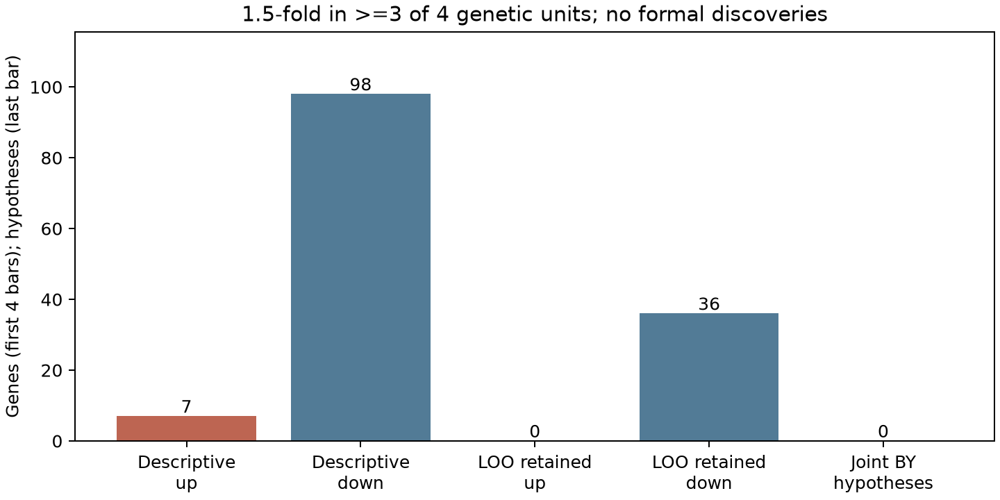
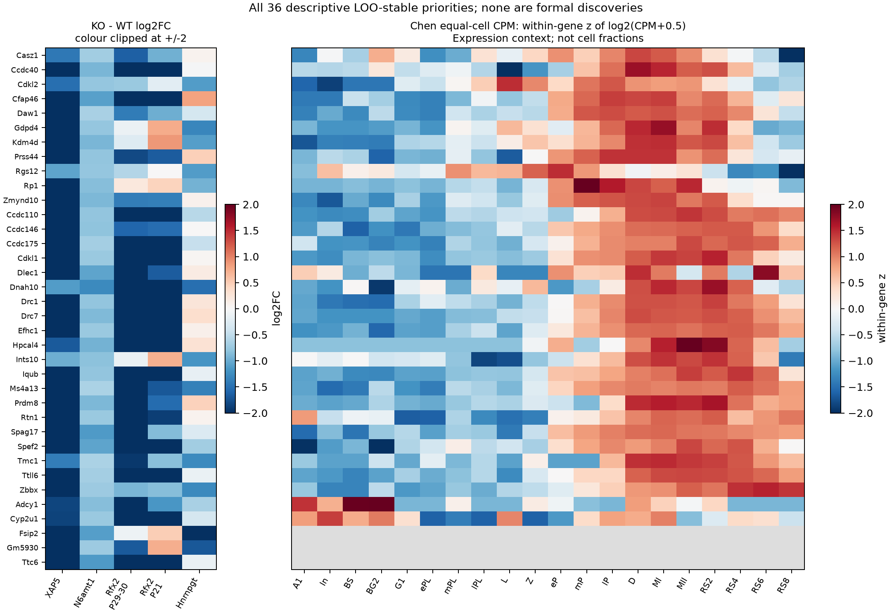
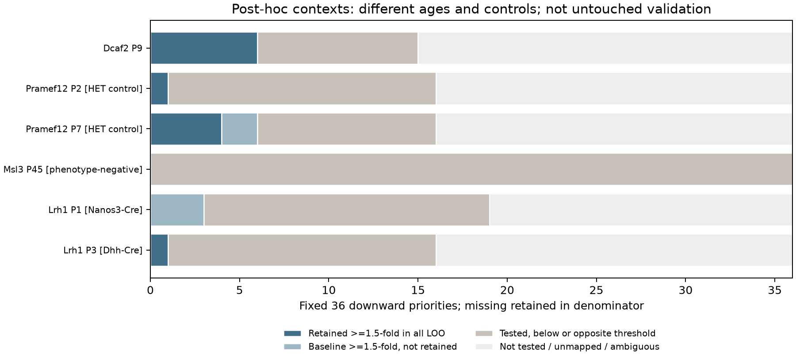

# 跨遗传模型的方向重复性与候选适用范围

日期：2026-10-26。状态：已执行；完成冻结输入核对、新目录计算复跑及代码测试。该分支回答“同一方向的全睾丸表达变化能否在多个遗传模型中获得统计支持”。它是探索性公开数据再分析，没有预注册，也没有新增动物实验。原八份结果快照及其绑定代码／规格保持不变。

## 结论

五个计数队列、40 份样本合为四个遗传单位，在 9,675 个共同受检基因上检验“至少三种”及“全部四种”模型的同向表达变化。主检验的联合 BY 校正没有检出发现；联合 BH 敏感性也没有发现。原八队列共同 8,099 基因的独立敏感性宇宙结论相同。不能据此宣布所有模型没有共享生物学，也不能将未校正排名改称已证实共性机制。

按效应值单独描述，有 7 个上调及 98 个下调基因在至少三种模型达到 1.5 倍变化；其中 36 个下调基因在至少三个固定模型中，同时满足完整拟合及该模型所有逐样本删除拟合的同向 1.5 倍条件。它们是后续核查的优先级表，**没有获得该筛选子表的 FDR 保证**。



## 分析单位及输入

| 遗传单位 | 计数队列 | 样本 | 保留的限制 |
|---|---|---:|---|
| XAP5 | GSE236388 | 6 | D16 睾丸臂 |
| N6amt1 | GSE283904 | 8 | 年龄未确认 |
| Rfx2 | GSE68283、GSE68284 | 9、11 | P29–30 与 P21 为同一遗传模型，要求两年龄均支持该方向 |
| Hnrnpgt | GSE101511 | 6 | 18 dpp；旧转录本计数经 Ensembl 79 映射，原 GTF 尚未恢复；功效有限 |

TPM 的 Rnu11、Agilent 的 Sin3a 及 Affymetrix 的 Dazap1 仅作为其他平台的效应注释，不增加主检验票数。P0 Sin3a 等年龄差异仍然存在。没有合并不同平台的原始表达矩阵。

主宇宙为五个计数队列均实际受检、效应有限且 P 值有效的 9,675 基因，不因芯片／TPM 缺失而删去。八队列宇宙 8,099 基因另作敏感性，未选择较有利的宇宙作为结论。覆盖记录见 [gene_coverage.csv](../replicability_snapshot/gene_coverage.csv)。

本轮从已准备表达矩阵重建原八个 limma 模型，逐基因核对 logFC、moderated t、双侧 P 值及原调整值。最大 t 差约 5.05×10⁻¹²，最大 P 值差约 1.03×10⁻¹²，均小于 10⁻⁸ 核对阈值。计数模型使用 filterByExpr、TMM、voom/limma；TPM 和芯片沿用原有趋势／稳健经验贝叶斯模型。没有重做 CEL 归一化、旧转录本注释或原始测序定量。

## 方向检验与多重性

从重建拟合的 t 和总自由度，用 R `pt()` 计算上、下调单侧尾概率；同时核对两尾和为 1、较小尾的两倍等于原双侧 P 值。单个模型有很强证据，并不足以证明多模型重复性。

Rfx2 的单位方向 P 值取两个年龄队列的最大值，为交并检验；方向及倍数描述分别保留年龄间最小上调效应／最弱下调效应，不用平均值掩盖反向变化。四个单位的同方向 P 值排序后，采用保守的 Bonferroni partial-conjunction：`min(1, (4-r+1) * p_(r))`，分别检验 `r=3` 和 `r=4`。该规则不要求单位 P 值独立，但要求各来源模型的 P 值有效。方法背景见 [Benjamini 与 Heller，2008](https://onlinelibrary.wiley.com/doi/abs/10.1111/j.1541-0420.2007.00984.x)及 [Wang 与 Owen 作者稿](https://artowen.su.domains/reports/PartialConjunction.pdf)。

主宇宙的 `9,675 × 2 方向 × 2 重复层级 = 38,700` 个假设一起做 BY 校正；敏感性宇宙的 32,396 个假设单独按相同规则校正。不按方向、重复层级或候选阈值分别选择较小调整值。BY 对依赖的处理及 SciPy 的整族展开语义见 [官方文档](https://docs.scipy.org/doc/scipy/reference/generated/scipy.stats.false_discovery_control.html)，理论出处为 [Benjamini 与 Yekutieli，2001](https://doi.org/10.1214/aos/1013699998)。另用 R `p.adjust` 对两个实际完整假设族独立复核，BY／BH 与 Python 输出的最大差均为 0。

| 主宇宙检验 | 最小未校正 P | BY 发现数 | BH 敏感性发现数 |
|---|---:|---:|---:|
| 下调，至少 3/4 | 0.0002610 | 0 | 0 |
| 下调，全部 4/4 | 0.0047920 | 0 | 0 |
| 上调，至少 3/4 | 0.0283735 | 0 | 0 |
| 上调，全部 4/4 | 0.0797340 | 0 | 0 |

两个宇宙的最小 BY 与 BH 调整值均为 1。完整 [检验表](../replicability_snapshot/directional_replicability_tests.csv.gz)保留所有假设；[primary_BY_findings.csv](../replicability_snapshot/primary_BY_findings.csv)只有表头，明确保存零发现结果。`top_ranked_hypotheses.csv` 的排名不能作为显著性门槛。FDR 控制的对象是整个假设族，不是去重后的基因表，也不是再经倍数、阶段或稳定性筛选的子集。

## 描述性候选及逐样本删除

| 同向效应条件 | 上调，≥3/4 | 下调，≥3/4 | 上调，4/4 | 下调，4/4 |
|---|---:|---:|---:|---:|
| 仅方向 | 1,836 | 2,405 | 199 | 291 |
| ≥1.5 倍 | 7 | 98 | 0 | 7 |
| ≥2 倍 | 0 | 7 | 0 | 1 |

倍数阈值不检验“真实效应至少达到该倍数”。它们与正式方向检验分开报告，不是为获得非空显著列表而降低校正要求。

从五份计数矩阵重新计算全部 40 次逐样本删除，逐变体对上旧缓存的受检基因集合及每个 logFC。9,675×5 个基因／队列组合中，48,330 个有完整变体，45 个因重过滤等原因不完整；后者不能通过稳定性条件。Rfx2 要求两年龄的所有相关删除变体均保留条件。留一结果不提供独立重复、置信区间或新的推断 P 值。

36 个稳定优先候选均为下调。逐模型同时满足完整拟合及所有删除变体的支持情况、实际效应与方向 P 值见 [candidate_unit_support.csv](../replicability_snapshot/candidate_unit_support.csv)；[stable_descriptive_priorities.csv](../replicability_snapshot/stable_descriptive_priorities.csv)保留全部 36 个及支持模型名称，不是只挑图中好看的基因。排序使用第三大的单位方向效应，未将两个 Rfx2 年龄平均。

## 两个来源的阶段表达背景

先给全部 9,675 基因做注释，再汇总 105／36 子集，使用精确 symbol，不猜测旧名或修复 Excel 日期基因。来源为先前已核对的 GSE107644 Chen 二十阶段均一细胞权重 CPM，以及 GSE112393 Green 十二生殖细胞群均值。原始／准备文件身份与 SHA-256 绑定在 [stage_annotation_design.json](../replicability_snapshot/stage_annotation_design.json)。这两个表达来源不来自主分析的四种遗传扰动；但在项目此前探索中已使用，不能称作事先未接触的验证集。

Chen 固定组为：精原 A1/In/BS/BG2；前细线 G1/ePL/mPL/lPL；减数分裂 L/Z/eP/mP/lP/D/MI/MII；减数分裂后 RS2/RS4/RS6/RS8。Green 为 GC1、GC2–GC8、GC9–GC12；其中 GC2–GC8 只标作“减数分裂或过渡”，不强贴细线／偶线标签。每组使用各阶段／群的等权算术均值，不因组内阶段多就用求和占优，也不按捕获细胞数重新加权；不在候选基因交集上重新归一化 CPM。

每个基因保留峰值组均值、峰值占组均值和的比例、细阶段峰值、缺失、全零和并列。另列峰值≥10 CPM、占比≥0.5 且不并列的描述性高占比标志，未用它筛选正式发现或宣称标志基因已验证。Chen 主宇宙缺失 36 个、另有 13 个测得全零；Green 缺失 34 个，源表另有 27 个非字符串基因行明确排除。

| 固定 36 个稳定候选 | Chen | Green |
|---|---:|---:|
| 精原峰值 | 2 | 3 |
| 减数分裂／过渡峰值 | 11 | 28 |
| 减数分裂后峰值 | 20 | 4 |
| 未测得 | 3 | 1 |

按可比较大类计，14/36 一致，19/36 不一致，3/36 不能比较。主要分歧是 16 个 Chen 减数分裂后峰值基因在 Green 中峰值落于减数分裂或过渡组。来源的年龄、捕获方法、阶段覆盖和归一化不同；这种分歧不能被隐藏，也不足以判定某个来源错误。这里没有做把相关基因当独立样本的富集显著性检验。



图左保留五个队列的 KO−WT logFC，两份 Rfx2 分开；颜色在 ±2 截断，表中保留完整值。右图为 Chen `log2(CPM+0.5)` 的逐基因标准化，灰色为缺失／无变化，不能跨基因比较绝对表达强度。行按阶段大类后按基因名字母顺序排列，未按外部匹配结果挑选。两个来源都主要覆盖生殖细胞，不是完整体细胞参考，不能由此计算细胞数比例或排除组成影响。

## 六个既有额外对比的事后情境检查

固定 105 个描述性候选和 36 个稳定优先候选后，对照此前已分析的全部六个额外对比。这里只复用冻结的差异效应及其逐样本删除缓存，没有在本分支重拟合这六组，也不增加主检验单位。此前已看过这些研究和整体相关结果，因此这是事后检查，不是独立确认性验证。全部 630 个候选／对比组合均保留在 [external_candidate_context.csv](../replicability_snapshot/external_candidate_context.csv)。

| 对比 | 固定 36 中受检且唯一映射 | 同向 ≥1.5 倍 | 完整拟合及所有留一仍 ≥1.5 倍 |
|---|---:|---:|---:|
| Dcaf2 P9 | 15/36 | 6/15 | 6/15 |
| Pramef12 P2，HET 对照 | 16/36 | 1/16 | 1/16 |
| Pramef12 P7，HET 对照 | 16/36 | 6/16 | 4/16 |
| Msl3 P45，表型阴性比较 | 36/36 | 0/36 | 0/36 |
| Lrh1 P1 Nanos3-Cre | 19/36 | 3/19 | 0/19 |
| Lrh1 P3 Dhh-Cre | 16/36 | 1/16 | 1/16 |

末列分母仍为完整拟合中可比较的基因；缺任何删除变体的基因不算通过。Lrh1 P1 的 19 个中仅 15 个有完整留一覆盖。未受检、未映射和歧义映射均保留为缺失，不填成无变化。Lrh1 在每次拟合内排除所有重复 symbol，不选择效应最大的 Ensembl 编号。



早期 P1–P9 组中这 36 个候选只有 15–19 个可比较，而整个 9,675 基因宇宙有 9,193–9,338 个可比较，提示候选的适用范围受到发育表达覆盖的明显限制；这不是基于独立动物的覆盖率显著性检验。不能把未受检解释为机制不存在。两个 Pramef12 年龄及两种 Lrh1 Cre 实验分别不是独立遗传模型；Lrh1 对照分别为 flox/- 与 flox/flox noCre，不改称 WT。Msl3 原文表型阴性不意味着每个转录本真实效应为零，也不能仅凭 0/36 宣称候选具有特异性。更早的来源核查见 [扩展记录](DATA_EXPANSION.md)与 [Lrh1 记录](FOLLOWUP_LRH1.md)。

## 复现、文件与用途

新入口使用 41 份冻结的本地输入，不主动联网：

```bash
# 从已准备矩阵重拟合八队列及 40 次计数留一，再做统计与背景检查
bash envs/python.sh scripts/run_replicability.py
# 新目录离线复跑；复用现有依赖
bash envs/python.sh scripts/check_replicability_reproduction.py
# 检查发布快照、绑定代码／规格及 41 份本地输入
bash envs/python.sh scripts/check_replicability.py --inputs
```

初次从头准备基线及额外来源仍需按主 README、扩展与后续记录运行上游步骤；41 份清单是本分支准备态输入，不冒充一键从公共原始数据开始。不要为复现随意重新生成冻结输入清单来接受改变过的文件。

新目录复跑的 **28 张表、4 份 JSON、3 张图文件一致**。其中两张大表为本地的重建来源统计及重建计数留一，不放入公开快照；其余 26 张表、设计与版本记录、图和复跑说明打包在 `replicability_snapshot/`。公开清单绑定来源闭包和规格；`results/replicability/`、原始矩阵、依赖环境和日志继续由 Git 忽略。83 项代码测试通过，涵盖重复性阶数、同一模型两年龄交并、全族校正、缺失留一、阶段等权汇总及外部 symbol 歧义／缺失处理。测试和新目录一致性只证明所列实现与数值可重现，不证明生物结论、经验 FDR 或全新机器安装成功。

实测环境：Python 3.14.7、NumPy 2.5.4、pandas 3.0.6、SciPy 1.18.1；R 4.6.1、edgeR 4.10.6、limma 3.68.5、data.table 1.18.6.1。环境版本另有机器可读记录，未把本机代理或绝对用户路径放进公开包。

这些成果可用于写出诚实的共性分析结果、定位哪些候选更适合后续核查、明确新增数据应优先补足的年龄和模型，而不能直接作为共享细胞内通路或临床标志物的验证证据。下一步应优先找有明确取样期、相应组织学表型、独立对照重复的青春前后全睾丸计数研究；在来源适用性未解决前，继续增加富集图不能补足证据缺口。
