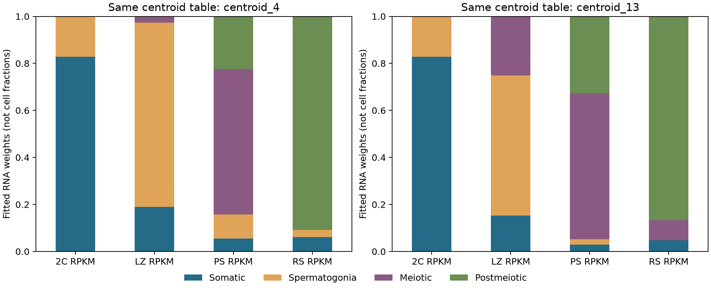

# 结果与结论边界

## 八队列效应不构成单一统一反应

所有效应方向为 KO−WT。以下数字来自八队列共同的 8,099 个受检基因，而不是按显著性挑出的基因集合。

| 比较 | Spearman ρ | 一次变动一研究的敏感性范围 |
|---|---:|---:|
| XAP5 / N6amt1 | 0.553 | 0.506～0.577 |
| XAP5 / Rnu11（TPM） | 0.755 | 0.706～0.776 |
| N6amt1 / Dazap1（芯片） | 0.768 | 0.718～0.786 |
| Rfx2 P21 / Dazap1（芯片） | −0.720 | −0.760～−0.657 |

范围包含适用的逐样本删除、伪计数或探针汇总变体，**不是置信区间**。这些例子支持几个方向不是由单一样本或本轮参数变体造成，但跨模型相似不能直接证明共享细胞内机制。年龄、平台和遗传扰动混杂，负相关也不能被解释为两基因必然互相拮抗。

Hnrnpgt 与 XAP5 的较弱关联在变体间可跨过零，不作稳定方向解释。Hnrnpgt 留一效应与全数据相关最低为 0.713（删除 GSM2705204），没有因此剔除该样本。P0 Sin3a 与其他队列整体接近不相关，不能据此否认其生物学作用。

详见快照 `all_cohort_comparison/`、`robustness/`，以及 `cohort_summary.csv`。八队列 DEG 数量依次为 XAP5 2,528、N6amt1 612、Rfx2 P29–30 888、Rfx2 P21 342、Hnrnpgt 4、Rnu11 10、Sin3a 94、Dazap1 2,194；不同技术和检验力下不作严重程度排序。

## 高重建分数不等于准确比例

同参考系精确 RNA 混合物中，旧 log 空间拟合即使留出重建分数较高，权重仍有系统性偏差；线性 CPM 在这种理想代数条件下可恢复权重，却不能据此说明它对真实组织准确。

同图谱留来源批次的 15 批次检查中，全基因加权方法的平均批次 MAE 约 0.0567，优于未加权约 0.0902，但这不是跨研究、独立动物或细胞数验证。

五个 counts 队列的组成预测表现不同。pooled 参考下预测与观察效应相关为 XAP5 0.717、N6amt1 0.791、Rfx2 P29–30 0.284、Rfx2 P21 0.652、Hnrnpgt 0.194。该检查只留出基因、仍依赖同一批生物样本；不能把相关平方写成因果组成解释份额。

## 外部检查暴露了参考适用性限制

独立分选资料中，已知 LZ 早期减数分裂群体在四类 pooled 参考下却由 Spermatogonia 占最大拟合权重，约 0.833。这个系数不表示真实分选群体“83.3% 是精原细胞”，也不是否定分选标签的证据。

换为作者的细分参考，在固定同一基因集合、基因权重及划分的受控比较中：

| pooled 体细胞谱下的诊断 | 同表四类参考 | 同表 13 成分参考 |
|---|---:|---:|
| LZ 的精原细胞拟合权重 | 0.785 | 0.596 |
| LZ 的 GC2–8 合计权重 | 0.026 | 0.251 |
| LZ 的五折基因预测 log2 RMSE | 1.548 | 1.564 |
| PS 的五折基因预测 log2 RMSE | 1.634 | 1.575 |
| RS 的五折基因预测 log2 RMSE | 1.809 | 1.723 |

更细参考改善了一些诊断，但 LZ 仍由精原类占最大权重，log 误差未改善。不能称为“细分后验证通过”。这些检查使用的共有基因集合不同于前一四类外部检查，不能将所有数值变化只归因于参考分辨率。

技术差异、年龄、阶段覆盖及外部七行数字异常和图谱 27 行日期化基因名均未完全解决。五折基因不等于五个独立实验；细分尝试已查看过同一外部资料，也不是最终独立验证。

## 当前结论

项目支持描述不同遗传模型的转录组异质性、部分跨模型效应关联的稳健性，以及成年单细胞参考的适用边界。它没有完成可靠的细胞数比例推断、组成因果贡献百分比估计或共享细胞内机制证明。

后续若希望推进组成定量解释，应取得年龄适配的参考、独立细胞标签与生物重复，并保留新的独立评估集；不应反复调参直至当前外部资料“通过”。当前结果适合报告为可复现的探索性再分析和方法假设审计，而非新机制已被证实。
