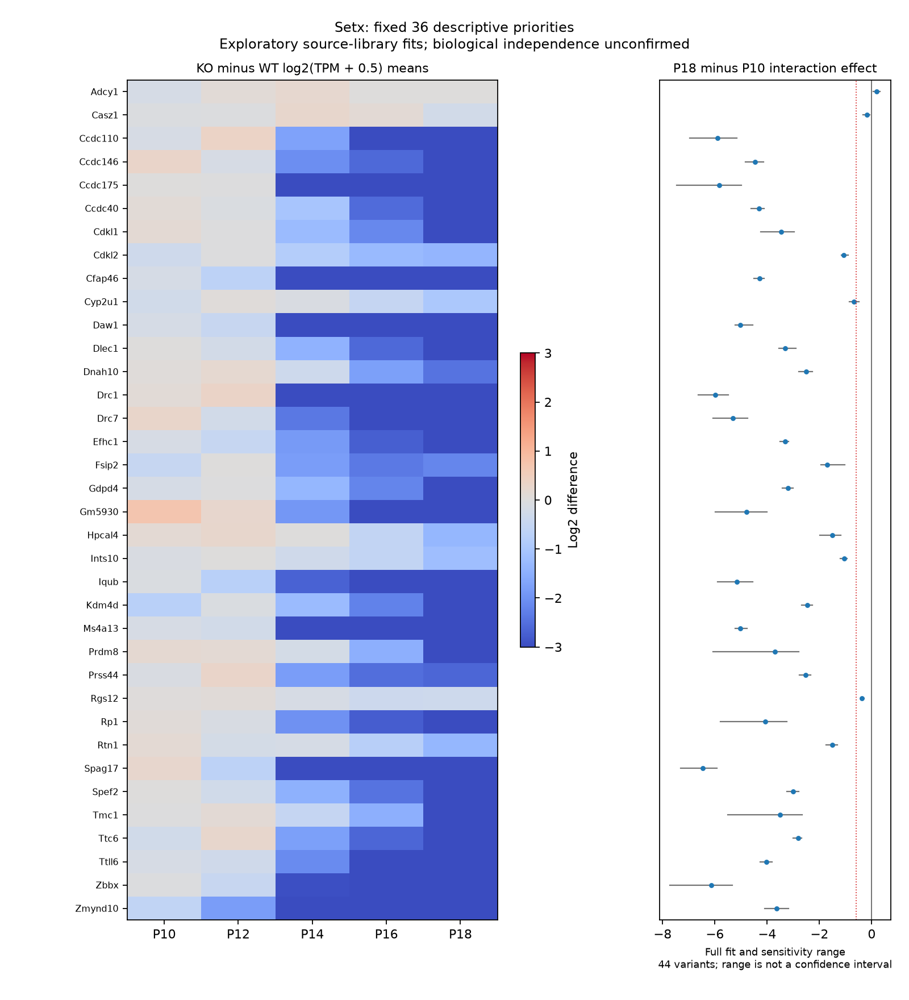

# Setx 年龄与基因型交互：条件性探索分析

本分支补上此前仅逐年龄比较所缺少的联合模型。**它是在看过既有年龄趋势后制定的探索分析，不是独立验证；也不改变四遗传单位主分析零正式发现的结论。** 代码、规格和结果另行冻结，既有十套快照及其绑定源码不改写。

## 数据身份与新发现的限制

从 GSE224875 原始处理文件 TAR 重新读取 40 份 GRCm38 基因 RSEM 表，并逐份核对既有 SHA-256。保留 55,401 个原始基因 ID，使用 TPM；不读取 piRNA，不将 estimated_count 四舍五入为原始计数。原始处理文件、源元数据和此前固定候选的身份记录在 `data/setx_interaction_inputs.json`。

文件名出现 39 个不同的来源编号。其中 **GSM7034763（WT P16）与 GSM7034783（Mut P16）都含 7844**。编号含义尚不清楚，不能确认是同一动物，也不能擅自更改样本标签。主模型保留原始分组，另做同时排除两份样本的敏感性模型。

20 个文件名条码 token 均嵌套在单一年龄×基因型组合中。十列细胞组均值设计秩为10；添加全部20列条码指示变量后，30列设计的秩只有20，因而无法同时识别任意条码效应与全部年龄／基因型组效应。**这不证明存在条码效应或批次伪差异**；它表明现有设计不能把这些可能效应分离。动物独立性、跨年龄采样关系、混样和实验批次仍待核实。

## 模型与检验对象

- 使用 P10、P12、P14、P16、P18 五个离散年龄、Control/KO 两组，共十个组均值；不假设年龄效应呈直线。
- 表达过滤先于候选筛选：任一组内至少 `min(4, n_group)` 份库达到 TPM≥1；样本删除后重新过滤。因此 P10 未表达而后期表达的基因仍可进入模型。
- 估计 `log2(TPM + 0.5)` 的组均值。对四个后期年龄分别计算 `(KO−WT)_age − (KO−WT)_P10`，用 limma 的 trend/robust 经验贝叶斯联合四自由度 F 检验。
- 主调整在全部通过过滤的原始基因 ID 上，每基因一个联合 F P值，采用 BY；BH 是敏感性。其他拟合分别调整自己的完整基因集合，交集计数是描述性稳定性统计，不另宣称错误发现率控制。
- 替代伪计数0.1和1；另做排除存疑 P16 样本对的38库模型；40次逐样本剔除只检查效应，不产生新的候选集检验。
- 先前105候选及其中36优先候选固定不变，仅在完整检验后按冻结且无歧义的符号映射注释。基因不作为独立动物。

交互对比的符号可由 [Bioconductor 官方设计矩阵说明](https://bioconductor.org/packages/release/workflows/vignettes/RNAseq123/inst/doc/designmatrices.html) 中的 difference-of-differences 理解。实现另以直接组均值复核所有交互系数，并以完整／加性嵌套模型的残差平方和及后验方差独立重算联合 F；最大相对误差小于 `1e-12`。这验证计算一致性，不验证生物假设。

## 结果

| 拟合 | 库数 | 受检原始基因 | 条件性 BY<0.05 | 条件性 BH<0.05 |
|---|---:|---:|---:|---:|
| 主模型，伪计数0.5 | 40 | 17,624 | 8,472 | 11,650 |
| 伪计数0.1 | 40 | 17,624 | 8,339 | 11,587 |
| 伪计数1 | 40 | 17,624 | 8,481 | 11,616 |
| 排除存疑 P16 对 | 38 | 17,712 | 9,224 | 12,067 |

38库模型 P16 每组只剩3份，过滤门槛也变为3，所以受检基因集合与主模型不同，不能直接用阳性数增减证明结果变强。四个拟合均达到条件性 BY 阈值的原始基因交集为8,119。较多交互可与后期组织／阶段构成变化相容；尚不能排除技术或来源设计因素，更不是8,472个共性机制基因。

固定36优先候选在全部44组拟合中都能唯一映射且通过过滤；其中35个的 **P18–P10 的 KO−WT 差异变化**始终为负，32个始终≤`−log2(1.5)`。这是一个比值之比的描述性幅度，不能等同于任一单龄 KO/WT 的1.5倍下调，也不意味着单调随年龄变化。P16样本对删除不会代数上改变 P18–P10 的组均值对比，但会影响联合检验的 P16 对比、方差及过滤。逐样本剔除范围不是置信区间，候选子集没有独立 FDR 保证。



## 执行与复现

```bash
# 仅使用已缓存且冻结身份一致的原始处理文件，不联网下载
bash envs/python.sh scripts/run_setx_interaction.py
# 独立核对完整检验家族、嵌套模型F、候选缺失与稳定性
bash envs/python.sh scripts/check_setx_interaction.py
# 新目录重新读取原始TAR和元数据，重新拟合全部44个变体
bash envs/python.sh scripts/check_setx_interaction.py --reproduce
```

新目录复跑匹配6张表、2份JSON、1张图，并逐值比较重新构建的完整 TPM 矩阵。复用安装的依赖和冻结注释；没有重新比对原始reads、重新联网、空环境安装、动物独立性验证或实验生物学验证。快照保存完整四模型统计、候选效应／稳定性、设计审计、运行版本与复现记录；完整 TPM 留在忽略目录。

下一步应优先核实来源编号、动物／批次及匹配的表型证据，再评估 RSEM 长度感知计数敏感性。当前数值复现不能替代这些工作。
