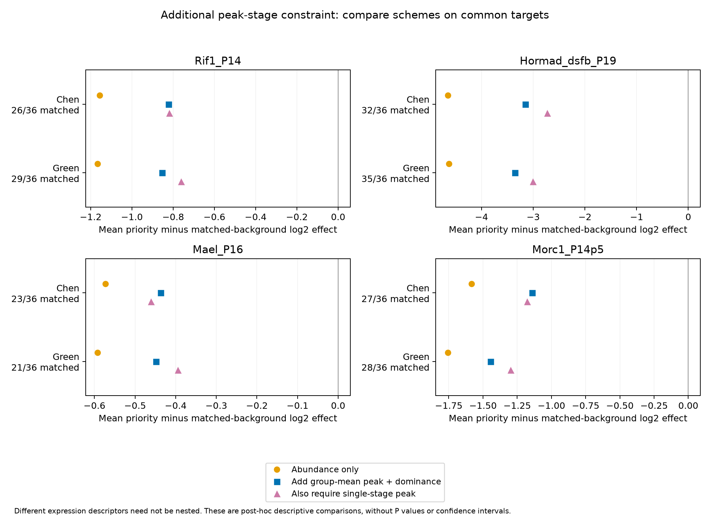

# Reference-informed candidate matching and Rif1 source refresh

The fixed descriptive priorities have more negative average source-level effects
than the selected matched gene neighborhoods. Stage-informed matching narrows the
contrast, and additional single-stage constraints change its magnitude. These are
post-hoc descriptive comparisons: they neither remove cellular composition nor
establish a common cell-intrinsic mechanism. The original primary family retains
zero adjusted directional replication discoveries.

## Question and timing

The analysis asks whether the original 36 priorities differ from other genes with
similar control abundance and reference-stage expression descriptors. Their earlier
outcomes, the source fits and reference limitations were already known. The initial
matching contract was specified before inspecting these matched summaries. Median
and delete-one-priority influence diagnostics were added after the initial means;
an additional peak-stage constraint was specified after inspecting the coarse
comparison. These timings are explicit in the two contracts. None is a preregistered
or untouched validation analysis.

## Frozen inputs and matching

The background starts from the original 9,675-gene primary intersection and is
intersected with each additional source's tested, globally unique symbols. Only the
36 priorities are excluded from the background; other earlier descriptive candidates
remain eligible. The four contexts are the already analyzed Rif1 P14, Hormad1/2 SFB
P19, Mael P16 and Morc1 P14.5 sources. No new biological samples or primary votes
were introduced.

Original cached source count tables are reconstructed. Full-fit voom log2-CPM values
are recovered from the frozen filtered library sizes and TMM factors. Their all-library
means agree with the stored `AveExpr` to numerical precision. Matching uses only
the mean expression in the three controls. The library-normalization contribution
is a common additive shift across genes within a source and cancels in pairwise
abundance gaps; this cancellation is checked. The tested gene universe still comes
from the earlier full comparison.

Both reference views are retained separately. A valid peak-of-group-means label,
positive reference peak expression and a finite dominance share are required. The
primary abundance caliper is one log2-CPM unit; a half-unit sensitivity is retained.
The group-dominance caliper is 0.2. Every target needs at least five eligible background
genes. At most twenty nearest neighbors are retained, ranked by normalized abundance
and, where applicable, dominance distance, with symbol-based ties. Neither source
fold changes nor perturbation expression enter the ranking.

The initial comparison contrasts abundance-only matching with matching that also
requires the same native peak-of-group-means label and similar dominance. Both
schemes use the same eligible targets within each source/reference/caliper. Missing
or unmatched targets are reported against the fixed denominator of 36. Background
genes may occur in several neighborhoods: averages give equal weight to targets
and equal weight within each target's neighborhood. Genes are not biological replicates.

## The two peak descriptors are different

The largest mean across a broad group need not contain the largest individual-stage
value. For example, a single meiotic spike can coexist with a higher average across
round-spermatid stages. In the fixed priorities, the native single-stage peak falls
outside the highest-mean group for 9 of 33 comparable Chen annotations and 3 of 35
Green annotations. This is an aggregation distinction, not evidence of mislabeled
cells, and no source label was replaced.

The additional diagnostic requires both the native group-mean peak and the native
single-stage peak to match, alongside abundance and group dominance. It compares
all three schemes on targets matchable under every scheme. Consequently its means
must not be compared directly with the initial analysis without checking target
denominators.

## Observations

The initial branch reports 32 summaries. Across its 16 source/reference/caliper
comparisons, adding group-mean peak and dominance matching decreases the absolute
priority-background mean difference; all resulting mean and median paired differences
remain negative. This pattern does not estimate a percentage attributable to composition.

The additional peak-stage branch reports 48 summaries and retains 21–35 priorities
per comparison. At the primary abundance caliper:

| Context | Matched priorities, Chen / Green | Mean priority minus joint-matched background effect, Chen / Green |
| --- | ---: | ---: |
| Rif1 P14 | 26/36 / 29/36 | -0.820 / -0.762 |
| Hormad1/2 SFB P19 | 32/36 / 35/36 | -2.731 / -3.006 |
| Mael P16 | 23/36 / 21/36 | -0.461 / -0.394 |
| Morc1 P14.5 | 27/36 / 28/36 | -1.178 / -1.297 |

Effects are differences of source log2 fold-change estimates. Across both calipers,
all 16 joint-matched mean and median differences remain negative. The extra constraint
decreases the absolute mean difference relative to the coarse scheme in 12 comparisons;
the other 4 do not show that decrease. Mean and median summaries and delete-one-priority
ranges describe the selected genes; none is a confidence interval, gene-based P value,
new FDR-controlled gene set or additional animal replication. Full-fit effects are used;
background omission stability was not assessed or inherited from the earlier candidate
analysis.



## Rif1 metadata refresh

The [GEO series](https://www.ncbi.nlm.nih.gov/geo/query/acc.cgi?acc=GSE294151) still has
no linked publication. Its explicit BioSample and SRA experiment relations were
checked on 2026-10-30. A six-sample ENA batch request returned two samples; individual
lookups confirmed two and returned HTTP404 for four. A count-first SRA query then
resolved all six linked experiments and reconciled each experiment, BioSample and
GEO title. All six SRA records annotate P14, C57BL/6, male testis and source biological
replicate labels. Example records are [WT-1](https://www.ncbi.nlm.nih.gov/sra/SRX28237051)
and [sKO-3](https://www.ncbi.nlm.nih.gov/sra/SRX28237056).

Thus the earlier sample-level age gap is resolved from SRA, while the ENA incompleteness
remains explicit. Distinct archive records and replicate labels do not independently
establish distinct animals. The exact Cre/allele, phenotype and matrix-to-library-name
crosswalk remain unresolved. A targeted publication search did not resolve a source
article; this is not proof that none exists. Curated records exclude provider/contact
fields. There were twelve bounded direct payload requests, plus a targeted literature
web search; all payload downloads used the required local proxy. Retrieval followed
the [Kassis et al. (2026) procedural workflow, preprint](https://arxiv.org/abs/2609.00065).

## Interpretation and reproduction

The result supports investigating the descriptive priorities further, while showing
that their apparent contrast depends on the reference neighborhood. Coarse group
averages, individual peaks and dominance do not capture complete expression trajectories,
actual cell proportions, RNA content or perturbation-induced within-cell changes.
Reference-transfer failures, heterogeneous ages/controls, prior candidate selection
and unresolved source structure remain. No causal fraction of the bulk effect is
assigned to composition or intrinsic regulation.

```bash
# Obtain preceding frozen public inputs if absent; downloads require the local proxy.
bash envs/python.sh scripts/fetch_independent_contexts.py
bash envs/python.sh scripts/fetch_stage_sources.py
bash envs/python.sh scripts/run_stage_specificity.py
bash envs/python.sh scripts/run_stage_resolution.py
bash envs/python.sh scripts/audit_stage_sources.py
bash envs/python.sh scripts/plot_stage_specificity.py
bash envs/python.sh scripts/check_stage_specificity.py --reproduce
```

A fresh directory reconstructed four count matrices and matched eleven tables,
five JSON records and two figures. Installed dependencies and cached processed
inputs were reused; raw reads were not realigned and biological experiments were
not repeated. Existing snapshots, contracts and bound sources remain unchanged.
